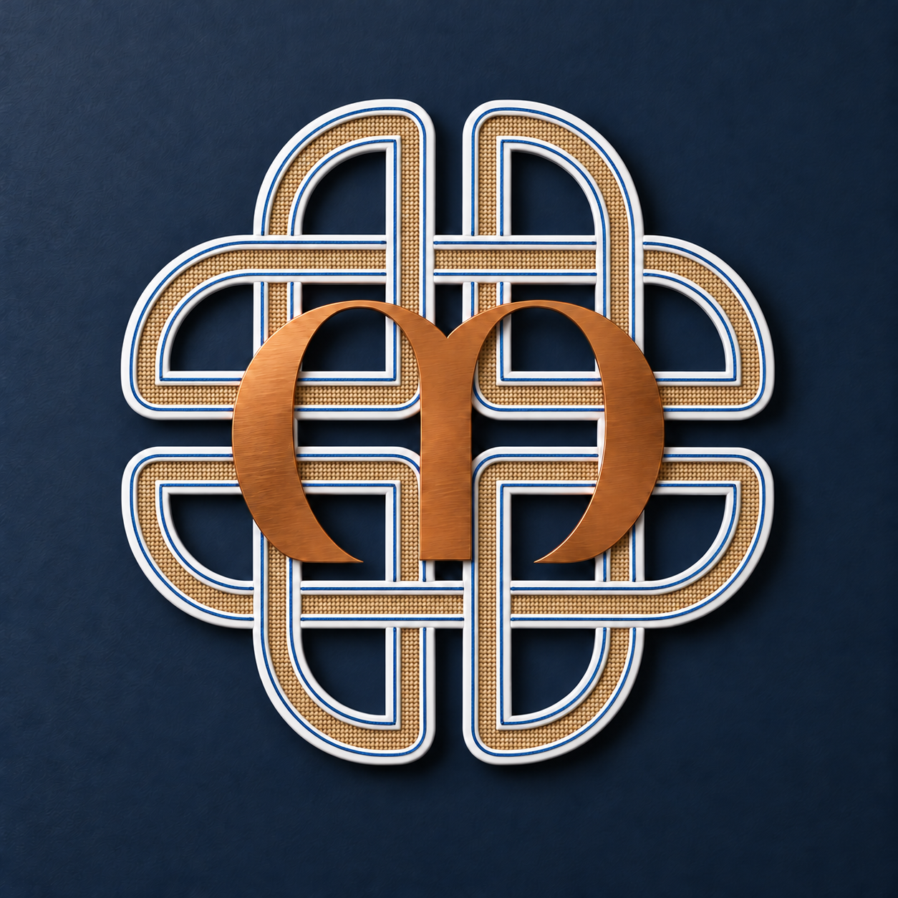
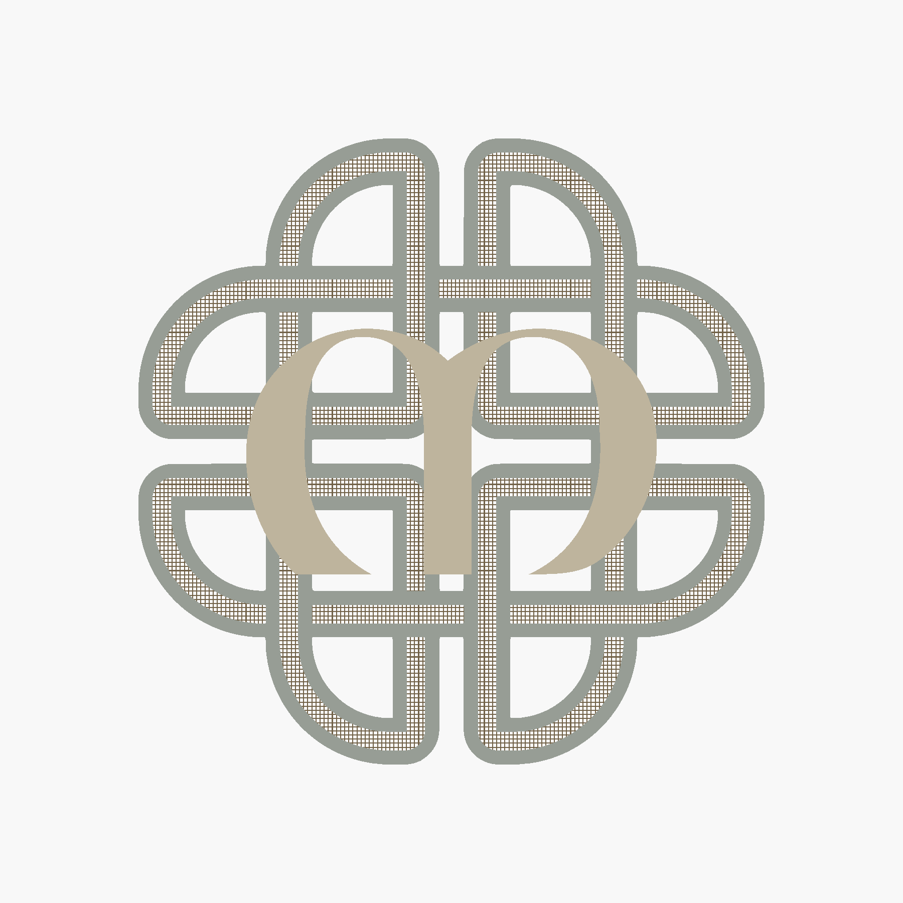

# Dara knot wall hanging

Concept rendering: white ribbon with a fine Azurite blue edge thread, wood-tan
woven fabric, and a copper manuscript M on a dark blue wall.

**Complete edge reconstruction:** the frame now uses tangent lines and circular arcs throughout, including regenerated section clipping and joint endpoints. Both working CAD files, all frame/backer STLs, color modifiers and all 31 Bambu slices are synchronized. The earlier local repair missed gradual waves; the [new complete review](working/review/clean-edges/README.md) measures the saved perimeter paths as well as the CAD and meshes.

Use the current [manufacturing CAD](working/Dara-Photo-Frame-A1-Jointed.scad), [continuous clean artwork](working/Dara-Clean-Artwork.scad) and [SVG](working/Dara-Clean-Artwork.svg). Historical files under `reference/` document the original traced design and are not current production geometry. Plate 30 remains the physical finish/color check.

The [final print review and first-print sequence](working/bambu/Dara-Photo-Frame-A1-Jointed/PRINT-READINESS.md)
records the digital checks. The user has printed the earlier hardware/lap
test pieces and reported insufficient photo clearance. The jointed model now
has 2.4 mm deep rabbets, giving the 1.6 mm backer 0.8 mm of photo and surface
clearance. The extra 0.4 mm addresses the reported fit issue; the revised
physical fit has not yet been checked. The two remaining
[material tests](working/stl/Dara-Print-Checks/README.md) have separate plates.

The [complete Bambu Studio project](working/bambu/Dara-Photo-Frame-A1-Jointed/Dara-Photo-Frame-A1-Complete.3mf)
contains all 70 assembly pieces on plates 1-29, a **68.36 x 24.00 mm white/wood/blue
weave-and-edging sample alone on plate 30**, and the **copper M test alone on plate 31**.
The already printed hardware and lap coupons have been removed from this project;
their standalone STL files remain available. The weave has alternating raised
crossings restored from the earlier texture, and its color region follows the
surface relief. The
[printable part and plate map](output/pdf/Dara-Part-and-Plate-Map.pdf) identifies every
part in the assembly and shows the shared backer and hardware plates. The project
uses four wall loops, 15% gyroid infill, and local 100% screw and mounting zones.
The saved AMS palette is **1 white / Generic PLA, 2 wood tan / Generic PLA,
3 copper / Generic PLA Silk, 4 Azurite blue / Generic PLA**. Frame sections
print their shallow weave in wood and a **flush 1.5 mm blue line** on each
fabric-facing white rail. A 1.25 mm white gap separates the line from the weave.
The blue modifier is 0.6 mm deep; it prints in the final three rail layers,
after the wood is complete. The M sections print entirely in copper. Match these project colors to your
loaded AMS Lite spools in the print dialog. No painting or separate weave inserts
are needed. Use the 3MF to retain these assignments; STL files contain geometry only.
The [actual CAD color map](working/review/blue-ribbon-edge/assembly-color-map.png)
shows the continuous edge path used by the section modifiers.
See the [project notes and verification](working/bambu/Dara-Photo-Frame-A1-Jointed/README.md).
Run `git lfs pull` after cloning to retrieve the 3MF and STL files.

The jointed model's [individual STL exports](working/stl/Dara-Photo-Frame-A1-Jointed/README.md)
contain all 39 distinct printable parts, stored with Git LFS. Print one of each
frame section, letter section, backer, and wall block, plus 32 copies of the
universal retainer. The export folder includes mesh checks and regeneration
instructions.

The jointed manufacturing model is
[working/Dara-Photo-Frame-A1-Jointed.scad](working/Dara-Photo-Frame-A1-Jointed.scad).
It now includes four separate keyed wall-mounting blocks. Each block is
140 x 38 mm with a 10 mm stand-off and two 20 x 10 x 3 mm locating keys.
The matching blind slots are in F3, F5, F16, and F18. Each block fastens
to the knot with two of the same #6-19 x 1/2-inch pan-head screws used for
the photo tabs. The keys locate the block; the screws secure it.
The four wall-facing surfaces share one plane and leave
4.5 mm behind the default photo tabs and modeled screw heads, before adding
any strip thickness.

Each block has two 9 mm counterbores with 3 mm seats and 4 mm through holes.
The knot pilots are 3.175 mm diameter and 10.7 mm deep: screw engagement is
9.7 mm, with 1 mm tip clearance and 2.8 mm of material remaining at the front.
No washers are needed. The modeled 7 x 2.5 mm heads sit 4.5 mm below the
block's wall-facing surface at the default stand-off.

Each block has a flat, uninterrupted 95 x 20 mm strip area along the opposite
edge from its two counterbores, also clear of the keyhole. Apply the strip
after installing the block screws. The separate keyhole has a 9 mm head entry, 4.5 mm
shaft slot, 4 mm deep hidden head channel, and 3 mm retaining lip. Insert
the screw head through the lower round opening, then lower the frame 11 mm
to seat it. Starting screw dimensions are a 4 mm shaft and 8 mm head;
choose the screw projection to fit the lip and channel. Strip dimensions
are a generic allowance, not a verified Command product or weight rating.

Use `wall_blocks` to arrange all four blocks rear-down within 140 x 182 mm,
or `wall_block` and `wall_mount_index` to select one. B1/B2 are upper
left/right and B3/B4 lower left/right **when viewed from the front**;
their key patterns differ. `wall_mount_detail` shows the selected block
and actual knot slots; set `wall_mount_explode=0` to inspect the seated fit.
`wall_keyhole_detail` sections the head channel, and `wall_fit_sample`
provides the selected block plus a separate slot coupon. `show_wall_blocks`
only changes assembly visibility: frame slots remain in previews and exports.
`wall_standoff`, key clearances, and screw dimensions are adjustable.
Check the coupon with the actual hardware before
printing the affected frame sections. The enclosed keyhole channel needs
a local bridging/support check; the CAD has not been physically load-tested.

- [Rear assembly with the four blocks](working/review/wall-blocks/assembly-rear.png)
- [Exploded mounting detail](working/review/wall-blocks/mount-exploded.png)
- [Four keyed blocks](working/review/wall-blocks/blocks-keys.png) and [keyhole section](working/review/wall-blocks/keyhole-cutaway.png)
- [Wall-mount geometry verification](working/review/wall-blocks/verification.json)

Its photo retainers are separate 20 x 10 x 3 mm rotating tabs, four per photo,
installed after printing with the selected
[#6-19 x 1/2-inch pan-head screws](https://www.amazon.com/dp/B00GDYBX9O).
The knot sections print rear-down at Z=0 without projecting retainer tracks.
Tabs have 4 mm clearance holes; the frame has 3.175 mm blind pilots, 10.7 mm
deep at the default tab thickness. This leaves 1 mm beyond the screw tip and
2.8 mm of front cover. No photo-retainer washers or countersinks are needed.
Loosen each screw slightly, turn the tab 90 degrees to release the backer,
and snug it again after closing. The assembled tabs and screw heads project
behind the knot; they are not present during frame printing.

In this jointed file, `retainer` shows one tab flat for printing, `fit_sample`
lays out a full-depth frame coupon, backer strip, and tab separately, and
`retainer_detail` shows the assembled screw stack. `retainer_cutaway` toggles
the detail section; `retainers_open` rotates the installed tabs. Metal screws
are preview-only. Photo-retainer thickness, pilot diameter, and clearance-hole
diameter have independent controls; pilot depth follows thickness to retain
1 mm tip clearance. Check the printed coupon with the actual screws before
printing the full frame. Existing rabbets and lap sockets still require local
support assessment. Lap profiles and M attachments are preserved; artwork and backers use the corrected outlines.

- [Retainer screw cutaway](working/review/photo-retainers/screw-cutaway.png)
- [Closed tab](working/review/photo-retainers/tab-closed.png) and [open tab](working/review/photo-retainers/tab-open.png)
- [Fit sample](working/review/photo-retainers/fit-sample.png)
- [Rear assembly](working/review/photo-retainers/assembly-rear.png)
- [Geometry verification](working/review/photo-retainers/verification.json)

The earlier, unsegmented feature model is [working/Dara-Photo-Frame.scad](working/Dara-Photo-Frame.scad).
The following sliding-retainer description applies only to that earlier design;
use the jointed manufacturing model and complete 3MF above for production.
Both working models now use the reconstructed clean outlines. The historical reference remains archived. The working CAD adds rear photo rabbets
to the eight outer openings, 1.6 mm removable backers, and four identical printed
sliding retainers per backer in integral rear T tracks. There are no screw holes.
The rabbets overlap the openings by 4 mm and allow 0.4 mm for a photo; backers
have 0.3 mm edge clearance. Tracks project 3.2 mm behind the original rear face,
and the slider grips project 4.5 mm. Push each slider inward to retain the backer;
pull it outward to remove it. Short tapered ribs provide friction retention.

The weave has a continuous solid CAD backing down to the rear face, allowing
the slicer to generate infill and solid skins without modeled internal partitions.
The knot uses the reconstructed continuous outline, with no M-shaped platform underneath the
separate letter. The M is a closed, flat-bottomed solid, 10.5 mm thick.

Use `view_mode` to select `assembly`, `frame`, `M`, `exploded`, `backer`, `retainer`,
or `fit_sample`. `backer_index` selects openings 1–8, clockwise starting at the
upper opening on the left side in the front view. `retainers_open` shows the sliders withdrawn.
`frame` excludes the M and removable hardware; `M` isolates the letter with its
bottom at Z=0. `exploded` lifts the M and separates the rear hardware for inspection.
The fit sample is a CAD detail of the track, keeper, and backer edge. PLA sliding
fit is provisional until physically checked; `slide_clearance` and `lock_rib`
adjust it. Hardware dimensions are finished millimetres. This stage supplies
CAD only, without print segmentation or production exports.

The historical design reference is [reference/Dara-Clean-Reference.scad](reference/Dara-Clean-Reference.scad).
It retains the original traced curves for provenance. Use [the reconstructed artwork](working/Dara-Clean-Artwork.scad) as the current visual baseline. It is a standalone OpenSCAD file
with continuous artwork outlines and editable display/dimension parameters.

The reference is 914.4 x 914.4 mm (36 x 36 inches), uniformly scaled to 75% of
the original in X, Y and Z. It keeps the manuscript M, open photo areas, and
decorative fabric. It has no part seams,
joints, connectors, mounts, photo-retaining features, rear labels, fabric backing,
support walls, cross-braces, or end ties. The fabric is represented by a thin open
grid; the knot rails and M have simple solid sections. This records the earlier design target,
before production segmentation and the complete curve reconstruction.

Open the SCAD in OpenSCAD and press F5. The top parameters toggle the knot, M,
and fabric. `fabric_style = "plain"` shows the fabric as a simple surface;
`view_mode = "drawing"` produces a flat front drawing for SVG/DXF export.
The default model has 13.5 mm knot depth, fabric at Z=9 to 9.6 mm, and the
M at Z=13.5 to 24 mm. The M follows the existing visible outline, approximately
600 x 359 mm. Fabric threads are 1.5 mm wide at 6 mm pitch and 0.6 mm thick.
`overall_width` controls uniform scaling of every part, including thicknesses
and offsets. The other dimension parameters describe the original 48-inch
master before scaling. Colours distinguish the components for review.

- [Angled view](reference/Dara-Clean-Reference-angle.png)
- [Rear view](reference/Dara-Clean-Reference-back.png)
- [Full-size vector drawing](reference/Dara-Clean-Reference-drawing.svg)
- [Source and outline processing record](reference/provenance.json)
- [Geometry verification](reference/verification.json)

The SCAD embeds native polygon outlines and needs no STL files, external fonts,
or Python installation. Keep this reference separate from future production
models. A matching review copy is saved in the existing Nextcloud package under
`CAD/Clean-Reference/`.

The optional `scripts/build_reference.py --source-package PATH` command
reconstructs the initial reference from the archived package (requires numpy,
shapely and trimesh). It uses the approved knot master and visible M face
contours, closes the M seams, and applies the channel-end and local curve
cleanup recorded in `provenance.json`. Running it overwrites the SCAD and resets
its parameters; make future design edits deliberately and regenerate previews
after changes.

## Physically tested joint reference

The [tested keyed lap joints](reference/tested-lap-joints/README.md) preserve the
75% straight and curved samples reported as rock solid on 2026-10-12. The folder
includes self-contained OpenSCAD reference CAD, print settings and verification
records. The exact test project is stored with Git LFS; test STL exports remain in Nextcloud. This is a separate joint
baseline used by the current jointed manufacturing model. Its six-wall, 30%
infill test preset differs from the production project's four walls and 15% infill.
