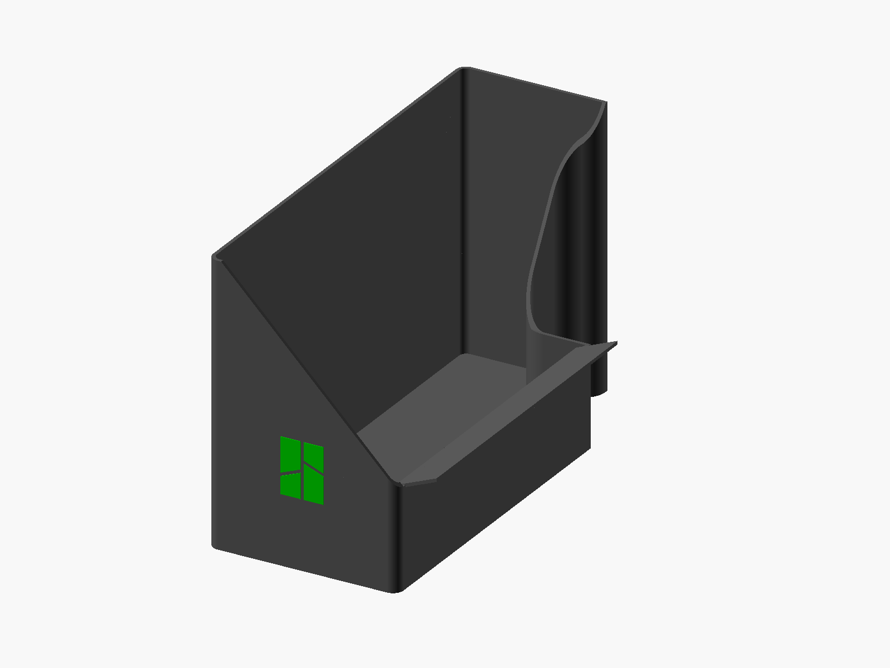

# A2L Poop Bucket

A single-gray bucket with a recessed Bambu mark on its triangular front,
full-height back and rear walls, a rising pillar wall and a catch chute.

## Files

- [Bambu Studio project](A2L-Poop-Bucket-SUNLU-PLA-Plus-2.0.3mf) — open as a project.
- [Standalone parametric CAD](Bucket.scad) — no external meshes or libraries.
- [STL](Bucket.stl) — one closed body with a blind recessed logo.

## Printing

| Setting | Saved value |
| --- | --- |
| Printer | Bambu Lab A2L, 0.4 mm nozzle |
| Material | SUNLU PLA+ 2.0, one gray slot #555555 |
| Nozzle / Textured PEI bed | 220 C / 65 C |
| Flow / maximum volumetric speed | 1.0 / 22 mm3/s |
| Layers | 0.20 mm, including the first layer |
| Walls / top / bottom | 4 / 5 / 5 |
| Infill | 8% gyroid |
| Supports | Automatic trees, default style, build plate only |
| Adhesion | Automatic brim |
| Purge tower / color changes | Disabled / zero |
| Estimate | 6 h 59 min; 294.5 g including supports |

## Dimensions

The body is 110 x 255 x 160.804 mm. The complete envelope including the chute
is 132.296 x 255 x 160.804 mm. Floor thickness is 1.98 mm and walls are 2 mm.

The printer housing measures **2.464 inches / 62.5856 mm** from the tabletop.
The chute underside begins at **2.504 inches / 63.6 mm**, leaving **0.040 inches /
1.0144 mm** nominal vertical clearance through the transition. The complete
chute is raised 5.574 mm while retaining its slope, thickness and 22.296 mm
projection. Its upper outer edge is **2.740 inches / 69.59 mm**; the lower edge
is 67.922 mm high. The root remains flush with the collection wall.
These mounting heights use the owner's measurement; the earlier reference
bucket height is historical.

The pillar interface remains 41.275 mm front reach, 15.621 mm rear return,
49.6568 mm nominal gap, 15.08125 mm (19/32 inch) inside curves and a 12.7 mm
(1/2 inch) convex rear tip. The enlarged body and its existing placement are retained.

Both sloping walls start at 65.441 mm (2.576 inches), matching the chute top
at the bucket's outside wall. The short runs between each slope and the chute
reach this same height. Their 2 mm footprints and the 160.804 mm tall ends are retained.

The Bambu front mark is 32 mm tall, centered at X55 with its bottom at Z40.
Its 0.6 mm (0.024 inch) recess leaves 1.4 mm of the 2 mm wall behind it.
The mark uses the same gray filament as the body, with no color changes.
Its polygons come from the retained Bambu Studio SVG reference.

## Verification

OpenSCAD exports one closed body. Solid comparisons confine all additions to
the existing front/rear wall footprints. Height checks cover both slopes and
both connecting wall runs; their starts reach the chute root's upper surface.
Five chute sections match the preceding model to within 0.000003 mm. The
underside clearance, pillar XY contour and recessed logo are preserved.
All saved print/material settings match the preceding project. Fresh native
slices and reopens show zero support extrusion inside the cavity, zero color
changes and no purge tower.

OpenSCAD 2021.01 F5 preview and F6 rendering both pass. The completed solid is
evaluated in one CGAL pass, and its export is byte-identical to the saved STL.
The build script also checks preview logs for errors even when OpenSCAD exits
with a success code. See the [CAD preview validation](history/openscad-preview-validation.json).

See [validation.json](validation.json) and the [printer clearance](reference/printer-clearance.json).
A physical print, logo finish and fit check have not yet been observed.

`build_project.py` rebuilds from this CAD and `reference/current-project-settings.json`.
Historical two-color evidence remains in `history/`. The Bambu PLA Basic
publication package is maintained outside this repository.
