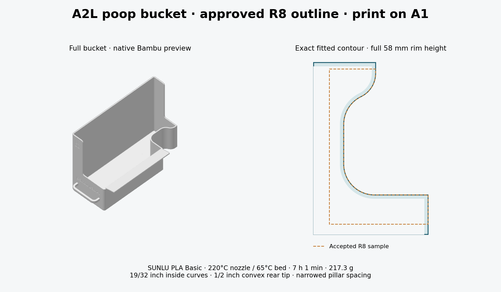

# A2L poop bucket — print on A1

Open [A2L-Poop-Bucket-A1-SUNLU-PLA.3mf](A2L-Poop-Bucket-A1-SUNLU-PLA.3mf)
**as a project** in Bambu Studio. This is the complete bucket with the approved
R8 pillar outline, not a fit sample. Revision r10 adds the requested automatic
tree supports, approved November 7, 2026.

| Setting | Saved value |
| --- | --- |
| Printer | Bambu Lab A1, 0.4 mm nozzle |
| Filament | SUNLU PLA Basic @Bambu Lab A1 0.4 nozzle, white |
| Nozzle / Textured PEI bed | 220 C / 65 C, first and subsequent layers |
| Flow / maximum volumetric speed | 0.98 / 12 mm³/s |
| Layer height | 0.20 mm, including first layer |
| Walls / top / bottom | 4 / 5 / 5 |
| Sparse infill | 8% gyroid |
| Supports / brim | Tree(auto), default / automatic, 5 mm saved width |
| Estimate | 7 h 1 min; 217.27 g PLA |
| Overall size | 112.296 × 244.164 × 150.804 mm |

The filament is the user's actual saved SUNLU profile, including its cooling
and other parameters. The Textured PEI bed changes from the old Generic PLA
project's 55 C to 65 C. All material differences are recorded in
[validation.json](validation.json). The support-only r10 revision changes
normal(auto) / snug to tree(auto) / default. All other saved settings, geometry
and the original print pose are identical to r9. No local presets were changed.

## Approved shape

The full floor and 58 mm-high rim follow the saved R8 mating contour: 19/32 inch
inside curves, the 1/2 inch convex blend at the short rear tip, and the narrowed
49.6568 mm nominal pillar spacing. The convex blend locally opens the tip;
the nominal spacing is measured from the original shoulder references.
Front reach is 41.275 mm and rear return is 15.621 mm.

The original full-bucket outer back wall remains 3.175 mm behind the flat
sample's back edge. The tested inner outline and convex arc are copied exactly;
the full bucket's outside size, handle, lip, lettering and tall catch wall are
retained. Floor thickness is 1.98 mm and walls are 2 mm. The sample's R8 marking
is not added to the bucket.

The owner approved the R8 design and requested promotion. A successful physical
R8 print/fit was not explicitly stated. Full-bucket fit, removal of generated
supports and clearance through the A2L's full motion remain to be checked.
No printer job has been sent.

## Files and verification

- [Bucket.scad](Bucket.scad) embeds the exact [Bucket.stl](Bucket.stl) triangles
  as a standalone mesh snapshot. It needs no adjacent files, so the STL can be
  uploaded as `A2L Poop Bucket.stl` without breaking the SCAD. This is fixed
  geometry, not a reconstructed parametric CAD history. Redundant
  microscopic triangles are cleaned within 0.0001 mm for reliable STL export;
  the native project retains its original validated mesh.
- [build_bucket.py](build_bucket.py) rebuilds the bucket from the exact geometry
  and settings snapshots in [reference](reference/). The snapshots include the
  approved R8 contour, original r4 mesh and actual SUNLU preset. No retired
  local sample scripts or downloads are required to reproduce the geometry.
- [validation.json](validation.json) records source/output hashes, full profile
  comparison, preserved regions, mesh checks, native A1 slice/reopen, material
  assignment, actual toolpath bounds and the G-code checksum.
- [Tree-support revision evidence](history/tree-supports-r10.json) records the
  exact two-setting change, unchanged mesh/poses, native tree generation and
  fresh slice/reopen. [The r9 report](history/r9-validation.json) retains the
  original normal-support publication evidence.
- [Standalone SCAD validation](history/standalone-scad-r1.json) records the
  November 9 packaging correction: OpenSCAD renders the file without a nearby
  STL, and its exported triangles match the existing STL exactly. The STL and
  saved Bambu project are byte-identical. MakerWorld's online validation has
  not been rerun here; upload the corrected SCAD to retry it.

The floor matches the accepted contour within 0.002 mm², and wall sections at
5, 30 and 57 mm match the promoted profile. The original handle/lip and geometry
outside the local change region were compared as solids. Native reopening and
754 model layers pass, with tree supports, interface paths and 3.129 mm minimum
conservative bed-edge clearance checked.
Native warnings are traditional-timelapse notices only. Digital verification
does not replace the physical checks described above.

SHA-256 of the current project:
`4d9983ad158bbb4c88227d3f3c256d8afc7d14418310c460010f2ec0ee54531a`

After pulling, run `git lfs pull`, then
`python scripts/audit_root_projects.py --accessories-only`.
The accessory is declared in [the repository catalog](../catalog.json), separate
from the seven completed Dara root projects. Earlier output-folder bucket and
sample files are historical and were not promoted as additional print choices.

The full legacy root audit currently stops at an older Letter veneer validation
hash mismatch. The same failure is present in the pre-bucket revision; the
Letter project and its records were not changed by this accessory release.

Personal adaptation of **A better Poop Bucket-A1 by PCH3D**, supplied by the owner:
[MakerWorld model 495125](https://makerworld.com/en/models/495125-a-better-poop-bucket-a1#profileId-409208).
Preserve the original attribution and Standard Digital File License restrictions.
