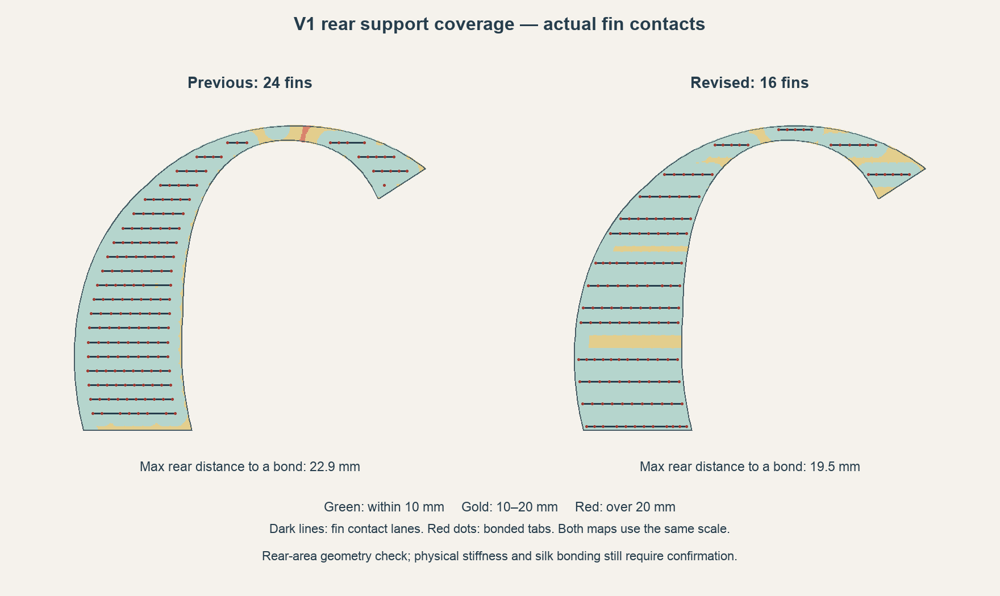

> Historical A1 release guide. The current main project is A2L; use [the A2L guide](../working/bambu/Dara-Photo-Frame-A2L/README.md) and its part numbers/settings. This A1 record is retained for the unchanged archived A1 project.

# M fin allocation from supported area

The revised full-size A1 veneers use **61 fins instead of 91**. The population was reduced by 33%, rather than forcing a 50% cut where the area and span checks require more support. Existing sample projects, including their printing plates, are unchanged.

The photographed curved crown lacked a bonded fin across its middle. The original row-end and tooth-grid filters could discard a narrow interval even when a legal tooth would fit at its center. The new placement retains those contacts and adds a directly grounded crown fin. Offset diagonal ties connect that fin to neighboring fins whose X ranges do not overlap; it is not left as a tall free sheet.

## Area and span checks

The allocator measures the actual clipped rear area, includes the bonded starter shoe, and assigns each small area cell to its nearest bonded tab. It tracks the area carried by each tab and fin, rather than relying on a uniform row pitch.

For a fin, its effective contact length is the span of its tabs plus one 8 mm tooth pitch. Dividing its assigned rear area by that length gives a tributary width. The trial load-sharing budget allows no more than twice that panel's original **average** area per tab and average tributary width. This implements the intended reduction in density while rejecting local concentrations above that budget. It does not allow a formerly under-supported crown to define the acceptable maximum.

A separate local-distance screen is based on a nominal 24 mm two-dimensional coverage grid: approximately 17 mm from a rear point to a bonded tab, with up to 3 mm additional allowance at protected cosmetic edges. Those dimensions are **geometric trial criteria, not tested silk-PLA strength or stiffness limits**. A half-population target does not override the criteria.

The planner uses area-weighted 1.5 mm cells. A separate audit reads the contacts from the generated carriers and repeats the measurements with **0.75 mm cells**. All six parts pass the finer audit, including the area and tributary-width budgets. The full rear area is accounted for, and no sampled area lies outside the specified distance screen.

| Veneer | Rear area, cm² | Previous fins | Revised fins | Previous maximum distance, mm | Revised maximum distance, mm |
| --- | ---: | ---: | ---: | ---: | ---: |
| V1 | 196.8 | 24 | 15 | 35.7 | 19.5 |
| V2 | 109.9 | 12 | 8 | 17.3 | 17.0 |
| V3 | 197.0 | 23 | 17 | 37.8 | 17.5 |
| V4 | 106.2 | 9 | 6 | 35.3 | 15.6 |
| V5 | 124.2 | 14 | 9 | 17.4 | 15.3 |
| V6 | 81.7 | 9 | 6 | 20.6 | 18.7 |

Distances are to bonded tab centers or the starter shoe on the flat rear plane; they are not slicer bridge lengths or a mechanical deflection prediction. Exact measurements, per-fin service areas and panel-specific limits are recorded in [M-fin-coverage-validation.json](../output/development/m-veneer-cosmetic-fit/M-fin-coverage-validation.json).

## Bracing and material checks

The fins remain 1.6 mm thick, with repeated bonded rear tabs and 0.40 mm recessed trim pockets. No main-body geometry, visible seam gap, veneer thickness or print rotation is changed. V1 and V3 move slightly on their beds to balance actual support-foot clearance.

The two tall plates also have a connected 2 mm wide, 1.6 mm high sacrificial perimeter guard, with its outside 0.8 mm from the bed edge. It keeps supplementary tree feet inward using actual geometry on those plates. Their model brim is disabled because the guard already provides broad bed contact. Remove the guard with the carrier. The knot plates retain their full usable bed and their original slices.

Every fin over 48 mm tall has diagonal restraint. Ordinary ties connect overlapping neighboring sheets. At the crowns, additional 45-degree ties bridge the offset between sheets. Boolean checks require one connected carrier/veneer body, preserve material above each rear trim pocket, reject unplanned contact with the show face, and verify the first veneer layer remains bonded to its grounded starter shoe.

Native slicing must additionally pass bead-inclusive bed bounds and model-extrusion probes through every bonded tab and starter patch. Trees remain supplementary support. These checks establish geometry, coverage and toolpaths; they do not establish cured silk bonds, stiffness under bed movement or safe support removal. Confirm a representative full veneer physically before committing to the remaining copper plates.

The A2L three-veneer proposal remains a separate study. Its new common orientation and taller carriers require their own area allocation and bracing checks; this A1 support layout should not simply be copied onto it.

## Native print estimates

The complete M, including unchanged cores, veneers, fins, ties, perimeter guards and supplementary trees, decreases from **1,780.68 g / 137.69 hours** to **1,595.62 g / 124.54 hours**. That saves approximately **185 g and 13.2 hours**. The 33% reduction in fin population does not translate into the same percentage for total material: the artwork, cores and remaining supports still print.

All twelve M plates pass native mesh/pose round-trip checking, bead-inclusive bed clearance of at least 0.8 mm, and extrusion probes through every bonded tab and starter patch. The main 36-plate project reopens successfully. Its 24 knot/hardware/finish plates retain their original slices. Existing sample projects, including plate 1, are unchanged.
