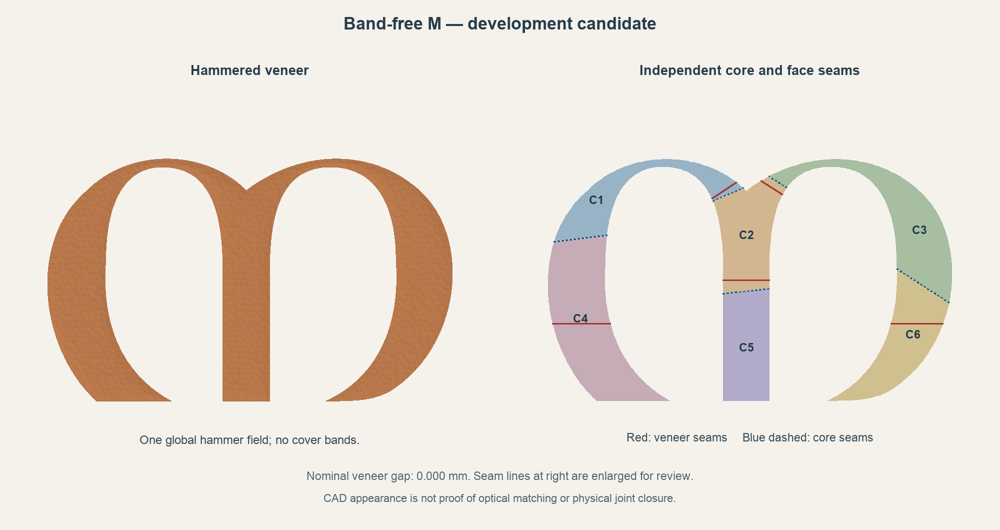

# Printing the flat core and veneer M

The current [main project](../Dara.3mf) contains 36 saved plates. Its M uses six flat cores and six matching veneers, with zero nominal cosmetic seam gaps and no cover bands.

## M print direction

All six veneers use the same complete 55-degree rotation, including the direction within the face plane. Their broad faces run along bed Y travel, with the lean across X. This keeps the layer orientation consistent after assembly while favoring the bed slinger motion direction. Keep the saved poses; do not rotate veneers individually or auto-orient them.

Cores print flat at 15% gyroid with four walls, five top/bottom layers and local solid screw reinforcement. Veneers and fused fin carriers print at 100%. The 8% body trial remains in the separate sample project. Filament slots remain 1 white, 2 wood tan, 3 copper silk and 4 blue.

## Plates and estimates

| Plate | Part | Hours | Filament g |
| --- | --- | ---: | ---: |
| 1 | F1 mirrored short seams | 6.8 | 123.9 |
| 2 | F2 mirrored short seams | 6.8 | 123.7 |
| 3 | F3 mirrored short seams | 8.5 | 143.3 |
| 4 | F4 mirrored short seams | 6.2 | 106.6 |
| 5 | F5 mirrored short seams | 8.5 | 143.4 |
| 6 | F6 mirrored short seams | 8.1 | 146.0 |
| 7 | F7 mirrored short seams | 6.2 | 110.1 |
| 8 | F8 mirrored short seams | 8.0 | 145.9 |
| 9 | F9 mirrored short seams | 7.7 | 135.2 |
| 10 | F10 mirrored short seams | 7.5 | 133.6 |
| 11 | F11 mirrored short seams | 8.0 | 140.2 |
| 12 | F12 mirrored short seams | 7.6 | 137.3 |
| 13 | F13 mirrored short seams | 8.1 | 145.8 |
| 14 | F14 mirrored short seams | 6.2 | 110.4 |
| 15 | F15 mirrored short seams | 8.1 | 146.0 |
| 16 | F16 mirrored short seams | 8.4 | 142.1 |
| 17 | F17 mirrored short seams | 6.1 | 105.9 |
| 18 | F18 mirrored short seams | 8.8 | 145.8 |
| 19 | F19 mirrored short seams | 6.8 | 124.1 |
| 20 | F20 mirrored short seams | 6.6 | 122.2 |
| 21 | C1 flat structural core | 2.8 | 48.7 |
| 22 | C2 flat structural core | 2.9 | 54.2 |
| 23 | C3 flat structural core | 3.5 | 64.9 |
| 24 | C4 flat structural core | 4.3 | 87.4 |
| 25 | C5 flat structural core | 2.5 | 47.3 |
| 26 | C6 flat structural core | 3.0 | 56.9 |
| 27 | Backers 1, 3, 5, 7 | 2.9 | 99.4 |
| 28 | Backers 2, 4, 6, 8 | 2.8 | 99.4 |
| 29 | B1-B4 and 32 Retainers | 8.8 | 150.9 |
| 30 | White wood and blue edge test | 1.4 | 18.4 |
| 31 | V1 veneer and bonded fin carrier | 27.1 | 304.0 |
| 32 | V2 veneer and bonded fin carrier | 11.4 | 129.7 |
| 33 | V3 veneer and bonded fin carrier | 43.4 | 564.4 |
| 34 | V4 veneer and bonded fin carrier | 12.5 | 147.5 |
| 35 | V5 veneer and bonded fin carrier | 11.8 | 130.8 |
| 36 | V6 veneer and bonded fin carrier | 12.5 | 145.0 |

The complete M, including its carriers and trees, is estimated at **1781 g and 137.7 hours**. The complete project is estimated at 4780 g and 302.4 hours, including optional finish plate 30. Estimates are slicer predictions.

Plates 1-20 and 27-30 retain their exact previous native slices. Plate 31 is now V1, and plate 32 is V2. The obsolete glue-practice pair was removed to keep the main project within Studio’s 36-plate limit; it remains in the [solid-M archive](../reference/production/Dara-Solid-M-Baseline.3mf). The current zero-gap tests remain in the [combined test project](../output/development/m-veneer-cosmetic-fit/All-Development-Tests-A1-Sliced.3mf).

## Cleanup and assembly

Use C1-C6 and V1-V6 together. Keep the 0.20 mm hidden veneer-to-core glue clearance and the seating/locator features. Remove the bonded fins and starter shoes while cradling the front, then sand the rear lands flat on the granite reference. Leave the hammer texture and cosmetic seam edges intact. Dry-fit the entire M before bonding; confirm a representative full part before printing every copper plate.

The knot geometry, backers, wall blocks, retainers and M attachment coordinates are retained. The old cover bands and solid M parts are superseded. Knot zero-gap refinements and the A2L fourteen-joint layout remain separate work.

See the [current assembly notes](../working/bambu/Dara-Photo-Frame-A1-Jointed/PRINT-READINESS.md), [printable part map](../output/pdf/Dara-Part-and-Plate-Map.pdf), [release validation](../working/bambu/Dara-Photo-Frame-A1-Jointed/m-veneer-release-validation.json) and [completion plan](PROJECT-GAME-PLAN.md).
