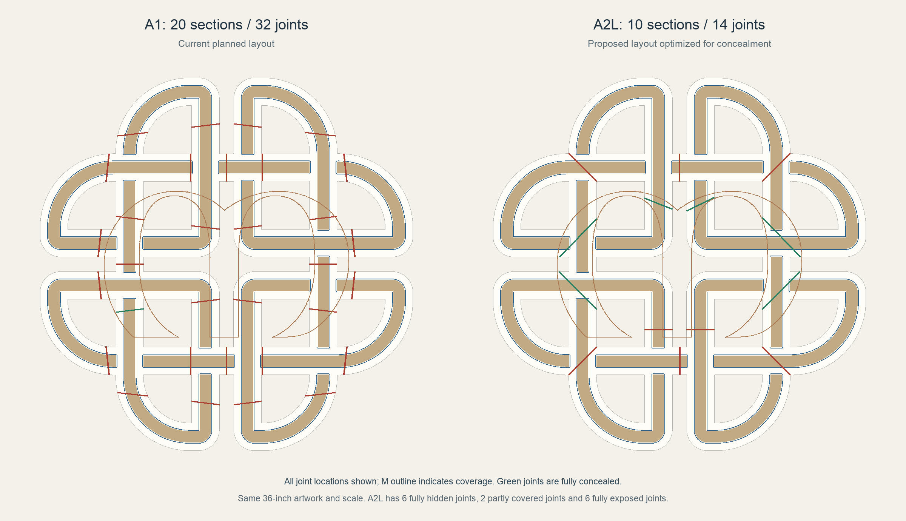
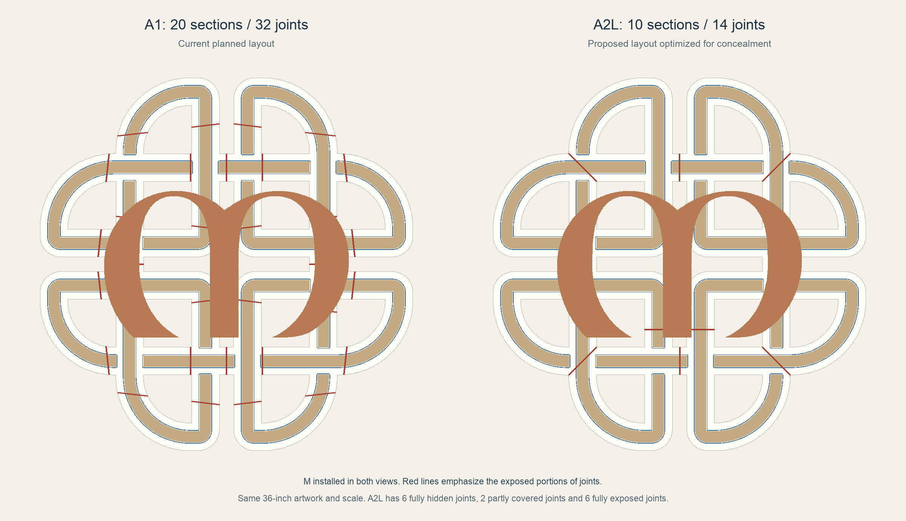

# Dara knot completion plan and A2L layout

Updated October 18, 2026. Working branch: `codex/m-veneer-cosmetic-fit`.

The goal is a clean wall artwork with the printed white, wood, blue and copper finishes exposed. Visible edges should meet without an intentional gap. Glue clearance belongs underneath. Hand fitting, support removal and sanding are acceptable when they improve the finished piece.

The M redesign is now integrated into the main A1 project: six flat cores on plates 21–26 and six Y-oriented veneers on plates 31–36. Physical sample/full-part confirmation remains pending. After the samples pass, retain their successful details, apply any needed adjustments, complete the knot refinements, and publish a matched final build. Choose the A1 or A2L knot layout **before printing the final knot sections**. The A2L option below reduces the knot from 32 joints to 14, with six fully behind the M, but still needs production modeling and slicing.

## Current tests and decisions

Use the [combined test project](../output/development/m-veneer-cosmetic-fit/All-Development-Tests-A1-Sliced.3mf), [plate map](../output/development/m-veneer-cosmetic-fit/All-Development-Tests-A1-plates.png) and [printable checklist](../output/pdf/Dara-Sample-Production-Checklist.pdf). There are 11 parts on three A1 plates.

| Plate | Contents | What it establishes |
| --- | --- | --- |
| 1 | Two white M cauls and the ribbon assembly jig | Usable support and reference surfaces during cleanup and bonding. The fixtures already printing remain valid. |
| 2 | Three M core coupons and three veneers with bonded fin carriers | Support stability in silk PLA, cleanup access, flat seating, correction of cupping, zero-gap veneer seam alignment and reflection. |
| 3 | One refined ribbon tongue and socket | Whether a zero nominal cosmetic gap closes flush in the actual materials, then stays aligned through bonding. |

Plates 1 and 3 retain their exact saved G-code from before the M seam revision; only plate 2 changes. The [preservation record](../output/development/m-veneer-cosmetic-fit/Zero-gap-plate-preservation.json) records the unchanged assets. The former A–D ribbon comparison sets are superseded.

Record these results before committing to full prints:

| Decision | A successful result | Action after success |
| --- | --- | --- |
| Ribbon joint | Visible white, wood and blue edges meet under light pressure; faces sit level without rocking; reflections match; the seam stays closed after cure. | Apply the same cosmetic closure and hidden seating/glue details throughout the chosen knot layout. |
| M support and cleanup | Silk veneer stays attached and stable during printing. Fins, tabs and starter shoe can be removed without cracking, marking the front or damaging seam edges. | Retain the proven carrier dimensions and common orientation; inspect every full veneer for equivalent support and trimming access. |
| M fit and finish | The cleaned flat back seats on the core without excessive force; the crown remains correct; adjoining copper surfaces align and reflect consistently. | Proceed with the flat-core construction, subject to the veneer seam detail below. |
| Infill | The 8% gyroid body coupons feel sufficiently rigid during handling, fitting and clamping. | Select 8%, about 12%, or 15% for structural bodies. Confirm the choice on a representative full section before committing the entire artwork. |

The body coupons have four walls and their saved solid skins. Veneers and their fused carriers remain at 100% infill. Full-size candidates currently remain at 15% gyroid. Small coupons do not establish full-size bending stiffness or long-term hanging performance.

Dry-fit before bonding. For the first bonded sample, use a suitable gap-filling two-part epoxy and the jig, with adhesive in the hidden relief and the seating stops/cosmetic edges dry. Record the product, preparation, working time and full cure. Use the same process on the final piece once the sample confirms adhesion to these exact filaments.

## Complete the flat core M

Retain the current construction:

- Six structural cores with constant 8.4 mm main body thickness and flat front/back planes, apart from local locating and seating features.
- Six veneers with flat backs at assembly Z8.6 and a 0.20 mm planar glue space. All 2.2 mm of broad convex crown and the hammered texture belong in the veneer. Nominal veneer thickness is 1.9–4.1 mm before hidden pockets.
- The original finished outline and front profile, with a maximum front height of 12.7 mm. Stagger core joints from veneer seams and omit the five cover bands.
- The same complete saved M5 orientation for every veneer: a 55-degree lean **and** matching in-plane direction. Matching the lean alone does not align reflections.
- Bonded sacrificial fins, repeated rear tabs, diagonal ties, connected bed frame and grounded starter shoe. Native trees supplement those restraints.

**The current M seam test has zero nominal cosmetic gap**, with the 0.20 mm veneer-to-core glue space retained underneath. Its actual front edges match with no geometric overlap; see the [M seam check](../output/development/m-veneer-cosmetic-fit/M-zero-gap-seam-validation.json). The complete six-veneer M now also has zero nominal gaps, and all five actual front seam edges match in the geometry checks. The main project retains the hidden glue and locator clearances, with all six veneers in the same complete Y-oriented pose. After the sample passes, keep this geometry or propagate any physical-fit corrections before the remaining copper prints.

For the full M:

1. Transfer any proven support or fit adjustments to all six veneers and regenerate the matching cores where required. Keep the existing M screw/locator positions for the A1 route; coordinate any A2L hardware moves with both the knot and M.
2. Preserve the shallow hidden screw-tip clearance pockets in the veneer. The existing screw envelope extends beyond the flat core; replacing the crowned body with a flat one does not remove that clearance requirement.
3. Check each full veneer for support access, supported first layers and enough remaining material over the rear trim pockets. A passing small carrier is not sufficient evidence for a longer unsupported span.
4. Print one representative full veneer and its core before printing all remaining copper parts. Check the larger part for warping, reflection and realistic clamping pressure.
5. Cut supports progressively while cradling the hammered face. Sand the broad rear bonding lands flat on the granite plate; the recessed trim pockets can stay recessed. Preserve seating features, cosmetic edges and the front texture.
6. Dry-assemble the full core on a flat reference, then dry-fit every veneer before bonding with the lined cauls and release film.

The [full M candidate](../output/development/m-veneer-cosmetic-fit/M-Core-and-Veneer-A1-Sliced.3mf) and [actual section preview](../output/development/m-veneer-cosmetic-fit/M-flat-core-section.png) preserve the current architecture. The [solid M orientation alternative](../output/development/m-veneer-cosmetic-fit/M-Solid-Common-Orientation-A1-Sliced.3mf) remains available if the veneer trial is unsatisfactory.

## Apply the ribbon result to the final knot

The current ribbon sample uses zero nominal gap above assembly Z8, below the lowest decorative surface at Z9. It retains the tested 18 mm lap, three seating pads, secondary-pocket relief and squeeze-out reservoir. The additional 0.20 mm adhesive recess produces 0.40 mm nominal total clearance in the recessed glue regions; the pads control face alignment independently.

The existing [full A1 knot candidate](../output/development/m-veneer-cosmetic-fit/Frame-Cosmetic-Candidate-A1-Sliced.3mf) still uses the earlier 0.075 mm cosmetic gap. After the new test passes:

1. Apply the zero-gap closing detail at every joint in the selected layout, including all colored surfaces crossing the seam. Preserve the hidden keys, glue relief and original artwork. Close the full cosmetic wall, not just its highest vertices, so a sloped wedge does not remain below the top edge.
2. Keep the seating pads supported by real material in both halves. Adapt their positions and the second locating pocket to each seam width and nearby features.
3. Preserve photo openings, backer clearances, retainers, mounting bosses and screw-tip material. Check refinements against these features rather than assuming the test joint represents every seam.
4. Keep knot sections flat on the bed. Compensate the surface-fill direction for each section's actual bed rotation. Target the established 135-degree white surface direction in assembly, and verify matching wood and blue paths at corresponding heights. Moving a piece is acceptable; rotating it requires recalculating that compensation.
5. Apply the chosen structural infill while retaining the agreed walls, skins and local 100% screw/mounting zones. Do not reduce veneer infill as part of this change.
6. Slice and inspect the largest section and a demanding joint before printing the complete set. Use ordinary and grazing light for the final visual check.

For an A1 build, retain the existing 20 knot sections and 32 joint centerlines. For an A2L build, use the new partition below rather than combining already-cut A1 sections.

## A2L layout with fourteen knot joints

The retained **lean candidate** is the third partition study, optimized to hide seams behind the M. It starts from continuous artwork and makes new cuts. The artwork remains 36 inches / 914.4 mm across.

| Quantity | Current A1 layout | A2L lean candidate |
| --- | --- | --- |
| Knot sections | 20 | 10 |
| Knot joints | 32 | 14 |

Of the fourteen A2L joints, **six are fully hidden, two are partly covered and six are fully exposed**. Eight therefore have some visible portion. The candidate removes 18 of 32 knot joints, a **56.25% reduction**. These counts exclude the M's core and veneer joints. Approximately 625 mm of knot seam remains exposed and 709 mm lies behind the M, including the covered portions of the two partial seams.

Green marks fully concealed joints. The copper outline shows the M footprint; the two partly covered joints are counted among the eight with visible portions.

### Joint locations and concealment

Joint numbers below follow the order of `joints` in [lean-candidate.json](../working/review/a2l-hidden-joints/lean-candidate.json). Section numbers belong to this A2L study and do not map to the existing A1 F1–F20 pieces. The tongue-to-socket direction identifies the proposed assembly relationship.

| Joint | Tongue section → socket section | M coverage | Seam length mm | Exposed length mm |
| --- | --- | --- | ---: | ---: |
| J1 | 2 → 1 | Fully hidden | 130.13 | 0 |
| J2 | 3 → 1 | Fully hidden | 73.50 | 0 |
| J3 | 2 → 3 | Exposed | 97.13 | 97.13 |
| J4 | 4 → 3 | Exposed | 67.30 | 67.30 |
| J5 | 5 → 4 | Exposed | 97.14 | 97.14 |
| J6 | 4 → 6 | Fully hidden | 75.16 | 0 |
| J7 | 5 → 6 | Fully hidden | 134.20 | 0 |
| J8 | 7 → 6 | Fully hidden | 130.71 | 0 |
| J9 | 8 → 6 | Partly covered | 68.11 | 56.39 |
| J10 | 8 → 7 | Exposed | 97.20 | 97.20 |
| J11 | 9 → 1 | Partly covered | 68.15 | 45.42 |
| J12 | 9 → 8 | Exposed | 67.30 | 67.30 |
| J13 | 10 → 1 | Fully hidden | 130.67 | 0 |
| J14 | 9 → 10 | Exposed | 97.11 | 97.11 |

The fully hidden seams have at least **2.04 mm of cover to the projected M edge** in the saved front-view check. That check used the original production M and its covers. Recheck the actual band-free M after the veneer and mounting revisions, and inspect typical oblique viewing angles: front-view coverage alone does not guarantee concealment from every angle.

The separate [18-joint alternative](../working/review/a2l-hidden-joints/more-hidden-candidate.json) adds four concealed joints but still leaves eight joints with exposed portions. Retain the 14-joint lean layout unless a later hardware or manufacturing constraint requires changing it. The older [12-section / 16-joint study](../working/review/a2l-optimization/verification.json) is a different partition, not the fourteen-joint solution.

### Bed fit and assembly assumptions

The study used a **330 × 320 mm bed**, reserving a 1.5 mm margin on every side for a **327 × 317 mm usable rectangle**. These are study inputs; confirm them against the actual A2L printer profile before producing files. The footprints below include the studied lap envelopes but still require native checks for brims, supports, purge, extrusion width and excluded bed areas.

| A2L section | Studied rotated footprint mm | Bed rotation degrees |
| --- | ---: | ---: |
| 1 | 315.66 × 306.00 | 101.24 |
| 2 | 283.03 × 274.38 | 92.27 |
| 3 | 307.96 × 298.54 | 24.06 |
| 4 | 310.00 × 300.52 | 156.32 |
| 5 | 283.02 × 274.36 | 87.74 |
| 6 | 318.06 × 308.34 | 78.95 |
| 7 | 262.21 × 254.19 | 176.33 |
| 8 | 309.79 × 302.63 | 105.74 |
| 9 | 319.38 × 309.61 | 161.77 |
| 10 | 262.23 × 254.21 | 3.70 |

The proposed lap is 18 mm. The study found complete stock coverage, no nominal section overlap, no overlapping lap domains and no meaningful invasion into a third section. Its directed assembly order is **9 → 8 → 10 → 7 → 2 → 5 → 4 → 3 → 1 → 6**. Confirm that order with the finished 3D joints and real glue/clamp access before assembly.

### Work required if using the A2L

The fourteen-joint result is a geometry study, **not a ready-to-print A2L project**. Complete these tasks before printing its final knot:

1. Rebuild all ten sections from continuous stock with the successful zero-gap ribbon detail, real keys, seating pads, hidden glue relief and color modifiers. Keep the original weave field continuous across the new cuts.
2. Resolve the saved hardware conflicts. M screw locations **1 at J2, 5 at J7 and 9 at J8** intersect the proposed lap regions. M locators **1 at J2, 2 at J1, 3 at J6, 6 at J7 and 11 at J8** also intersect them. These indices are from the study's original hardware tables. Move or redesign each affected feature and update the knot and M together; retain local solid reinforcement and screw-tip clearance.
3. Rebuild the four wall-block interfaces and matching blocks. The study proposes the centers below; these are candidate moves, not completed mounting geometry.

   | Wall block | Existing center mm | Proposed center mm | A2L section |
   | --- | --- | --- | --- |
   | 1 | −196, 224 | −172, 224 | 3 |
   | 2 | 196, 224 | 154, 224 | 4 |
   | 3 | −196, −224 | −180, −224 | 9 |
   | 4 | 196, −224 | 140, −224 | 8 |

4. Recheck photo retainers, backers, pilots, keyholes, remaining front material and rear clearance against the finished 3D joints. Keep all matching hardware in the same release.
5. Recompute the M coverage with the final band-free construction and hardware positions. Preserve at least the intended 2 mm front-view margin for the six hidden joints, or explicitly revise the seam layout/count if a move is necessary.
6. Build an A2L Bambu project using the actual printer/nozzle/material profiles. Compensate top-surface direction for the final bed rotations; do not reuse A1 compensation values after reorienting larger sections.
7. Native-slice every section and inspect bead-inclusive bed bounds, supports, purge tower, material assignment and seams. Update any tight packing before claiming the study's bed fit is printable. Fewer joints does not itself establish greater strength or lower total weight/time.
8. Print one demanding full section and matching joint before committing to the whole A2L set. The A1 coupons establish the local joint approach; larger spans still need a fit, flatness and stiffness check.

The fourteen-joint knot count excludes the M. A [separate fresh M study](../working/review/a2l-m-joints/README.md) now supports a candidate with four flat cores (three hidden joints) and three veneers (two visible seams), compared with six cores and six veneers on the current A1. Rotating all veneers together 90 degrees within the same 55-degree tilted plane keeps their show planes parallel to bed Y, while the A2L height permits full sweeps. Visible M seam length decreases from approximately 317 to 24 mm. An alternative retaining the exact current rotation has five veneers and four visible seams, totaling about 220 mm. The M candidate still needs regenerated 3D carriers, mounting checks, native slicing and physical confirmation; the current A1 main project remains unchanged by this study.

## Validate and release the chosen build

- [ ] Record the sample results, adhesive process and structural infill choice in the checklist.
- [ ] Choose A1 or A2L before cutting/printing final knot sections.
- [ ] Propagate zero cosmetic closure, hidden relief and successful support details; resolve the M veneer seam before releasing full copper prints.
- [ ] Verify watertight connected parts, mating interference, full seating-pad support, glue space, key clearances, photo clearances and matching hardware.
- [ ] Verify the original artwork, finished front profile and material boundaries, plus matched surface directions in actual sliced paths.
- [ ] Native-slice the complete chosen set and check every plate's extrusion bounds, supports, first layers, purge clearance and complete G-code.
- [ ] Confirm a representative full part, then dry-assemble the knot and M before glue. Check the front in grazing light and the rear hardware with the intended photos/backers.
- [ ] Publish a clearly named, self-contained Bambu project, updated part/plate map, assembly order, glue/cleanup notes, checklist and print estimates. Separate A1 and A2L releases so their section numbers and hardware cannot be mixed.
- [ ] Commit the generating scripts, source geometry, validation reports and final print assets on this branch; push Git LFS assets and verify the remote commit.

[Dara.3mf](../Dara.3mf) is now the integrated veneer-M main project. Preserve the [original solid-M release](../reference/production/Dara-Solid-M-Baseline.3mf) as the source and historical reference. Use the test projects and validation hashes in the current [development manifest](../output/development/m-veneer-cosmetic-fit/manifest.json); local rearrangement in Bambu Studio does not replace that validated baseline. On another computer, fetch/pull `codex/m-veneer-cosmetic-fit`, run `git lfs pull`, and open the relevant 3MF **as a project**.

## Retained design sources

- [Current development manifest](../output/development/m-veneer-cosmetic-fit/manifest.json), [M geometry](../output/development/m-veneer-cosmetic-fit/M-geometry-validation.json) and [zero-gap ribbon checks](../output/development/m-veneer-cosmetic-fit/Frame-coupon-validation.json).
- [A2L fourteen-joint geometry and hardware data](../working/review/a2l-hidden-joints/lean-candidate.json), [study verification](../working/review/a2l-hidden-joints/verification.json) and [source identities](../working/review/a2l-hidden-joints/sources.json).
- [A2L partition analysis script](../scripts/analyze_a2l_hidden_joints.py), [ribbon development script](../scripts/develop_cosmetic_joints.py), [M development script](../scripts/develop_m_veneer.py) and [combined-project audit](../scripts/check_combined_tests.py).
