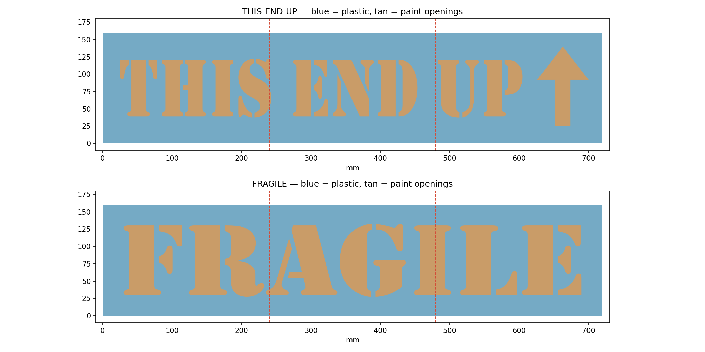
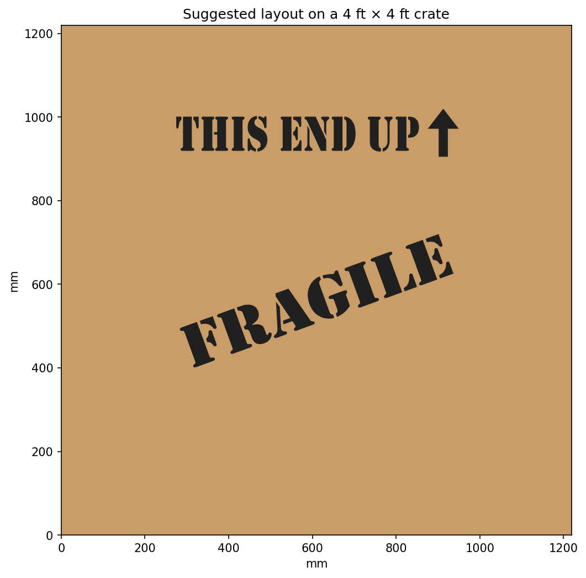

# Christmas crate spray stencils

Open **Christmas-Crate-Stencils.3mf** as a project in Bambu Studio. Six A1 plates,
one negative stencil tile per plate. These are sheets with letters/arrow cut
through them, not raised lettering. Inspired by the crate reference; the type
is Windows Stencil, not a tracing of the original movie prop.

Each assembled mask is **720 × 160 × 0.8 mm** (28.35 × 6.30 inches).
Each tile is **240 × 160 mm**, with 8 mm side clearance on the A1 bed.
The FRAGILE letters are 105 mm tall; THIS END UP is 85 mm tall.
Print at 100% scale, in ordinary PLA with a 0.4 mm nozzle, 0.2 mm layers,
four solid layers, no supports and no brim. Let the plate cool before peeling
off these thin sheets. Use any filament color; the color does not affect paint.
Sparse infill is disabled (0%, with the installed gyroid pattern). Four bottom and
four top shell layers cover the entire 0.8 mm thickness, so the sheets remain solid. All six
tiles use Bambu's three-column, two-row plate layout, including FRAGILE on plates
4–6. Reopen the updated project to replace settings and positions from an older copy.

The project is **unsliced**: choose Slice All in Bambu Studio before printing.
Native CLI validation was attempted, but the installed Bambu executable exited
at startup with code -18 and no diagnostic output. ZIP/XML structure, six plate
assignments, A1/0.4 mm settings, tile dimensions and solid geometry were checked.

1. Plates 1–3 form THIS END UP plus the upward arrow, left to right.
2. Plates 4–6 form FRAGILE, left to right. Tile filenames give the order.
3. Place the smooth bed faces down on a flat surface, with readable lettering
   facing up. Butt the straight tile edges together with **no overlap or gap**;
   align the long top and bottom edges. Tape across the seams on the exposed
   spray-facing side wherever there is solid plastic. Do not cover the cutouts.
   Some seams cross letters; trim tape away from every paint opening.
   For a permanent assembly, glue thin scrap-plastic splice strips onto the
   spray-facing solid margins only, keeping the crate-contact face flat.
4. Place THIS END UP horizontally toward the top of the crate. Rotate the
   complete FRAGILE mask about 20 degrees counterclockwise so the word rises
   to the right. The diagonal comes from positioning the mask; it prints flat.
5. Tape the perimeter to the crate and mask the surrounding wood with paper.
   Hold the sheet flush against the wood, especially at seams and letter
   bridges. Use light passes directed squarely into the openings. Try a scrap
   first; rough wood and lifted mask edges can allow underspray.

Letter centers stay attached via the stencil font's bridges. All six tiles
are individually connected watertight solids. The generator also checks that
reassembling the tiles exactly reproduces the complete negative masks.
Physical print and spray performance have not been tested.

Source: `scripts/build_crate_stencils.py`. Requires the repository's geometry
libraries, matplotlib, manifold3d, and `C:/Windows/Fonts/STENCIL.TTF` (not bundled).
Run from the repo with `python scripts/build_crate_stencils.py` to regenerate
the editable, unsliced project, STL tiles, previews, and geometry validation.
