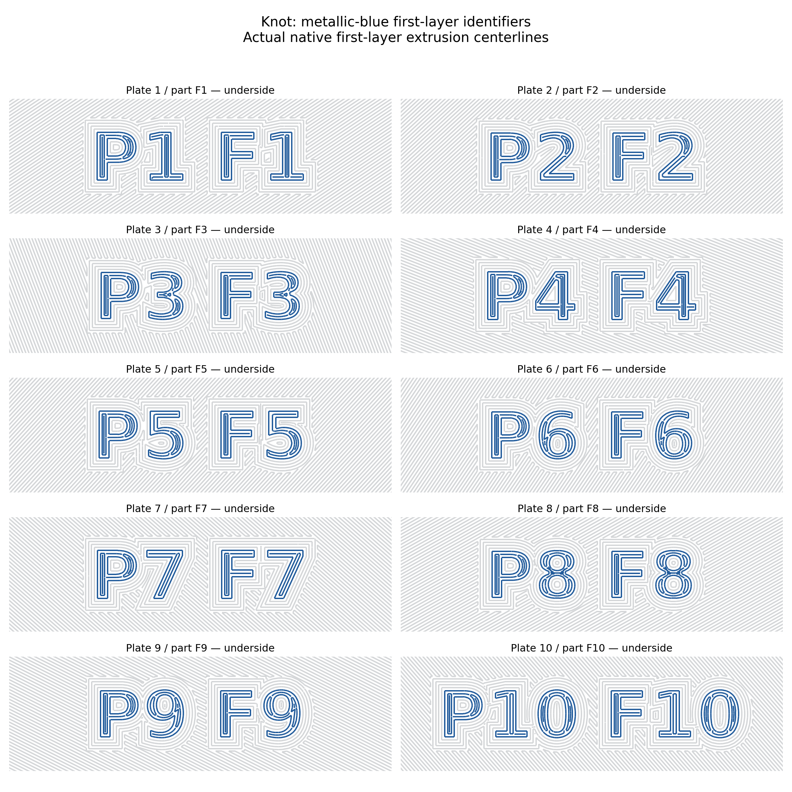

# Knot permanent underside identifiers — October 25, 2026

Current project: **root `Knot.3mf`**, Bambu Lab A2L, ten plates.

The user requested metallic-blue plate/part numbers in the first layer and
confirmed all ten Knot pieces. Each has **P1 F1 through P10 F10** printed flush
in its existing underside, using the saved slot 3 SUNLU PLA Metallic Azurite
blue. P means plate; F is the existing part identifier. Text is **8 mm tall**,
32–47 mm wide, DejaVu Sans Bold, mirrored in bed X so it reads normally when
viewed from below. The color mask covers **Z0–0.20 mm only**. Every glyph has
an interior at least 1 mm wide and sits clear of body edges, joints, holes and
screw modifiers. Nothing protrudes from or is removed from the part.

## Preservation and validation

- Ten new color-only modifiers; all original embedded mesh entries remain
  byte-identical, including stock, keys, grooves, reliefs, color regions, the
  28 solid-lap masks and all 50 Z12.4 screw reinforcements.
- All project settings, original object/volume overrides, paint and poses
  are preserved. Structural 8% gyroid, local 100% rectilinear laps, four walls,
  five top/bottom layers, 0.4 mm nozzle, 0.20 mm layers, textured PEI, normal
  supports and infill-first off remain. The five blue show-face layers remain.
- All ten plates freshly sliced with native Bambu Studio and the final editable
  geometry/settings reopened natively. The delivered project retains all ten
  new G-codes; the CLI reopen export omits its toolpath cache.
- Every glyph is present in the native first-layer extrusion paths. Minimum
  label coverage is 99.19%;
  minimum white second-layer backing is 100.00%.
  Blue model extrusion occurs only at Z0.20 and the original five upper layers
  Z12.8/13.0/13.2/13.4/13.6. These percentages measure commanded bead coverage,
  not physically deposited material.
- Checked G-code settings/checksums, bed and tower clearance including supports
  and brims, unchanged top-surface directions, and 140 key/groove layer pairs.
  Minimum commanded key clearance: 0.1279 mm.
  Native warnings are limited to the existing traditional-timelapse notice.
- Model extrusion segment geometry, filament assignments, feature types and
  widths above the first layer match the preceding solid-lap release on every
  plate, including the lap fill and screw skins. Travel and purge are excluded
  from this comparison; all saved settings remain unchanged.
- Adjacent label STLs, `Knot.scad`, catalog and slice hashes are synchronized.
  All pre-existing Knot STLs and other root projects/CAD/STLs remain unchanged.

These digital checks do not establish physical label legibility/durability,
full-size joint fit or surface quality. No printer job was sent.

## Native estimates

| Identifier | Time | Material |
| --- | ---: | ---: |
| P1 F1 | 8h 20m | 252.83 g |
| P2 F2 | 7h 25m | 220.16 g |
| P3 F3 | 9h 14m | 267.31 g |
| P4 F4 | 9h 17m | 268.28 g |
| P5 F5 | 7h 30m | 220.38 g |
| P6 F6 | 8h 04m | 250.30 g |
| P7 F7 | 7h 37m | 221.01 g |
| P8 F8 | 9h 06m | 262.99 g |
| P9 F9 | 9h 03m | 265.38 g |
| P10 F10 | 7h 37m | 221.27 g |
| **Total** | **83h 13m** | **2449.90 g** |

Estimates include supports and purge structures. First-layer blue adds color
changes and purge material with the existing saved purge settings.

Production SHA-256: `b33d28f0fc7277758928321a09196929a53d5c63b5503548a51b408cb4f6e626`.

Source SHA-256: `78f22d0ff7e22da7e27a3fd4c761c1aa815a5bb26c3acea3392cbd23797c52e6` (accepted solid-lap production revision).

`provenance.json`, `editable-preservation.json`, `validation.json`,
`joint-toolpaths.json`, `native-result.json` and `native-reopen.json` bind the
checks to these files. Prior solid-lap/sample reports remain historical evidence
for the source geometry. Run `python scripts/audit_root_projects.py` after pulling.
