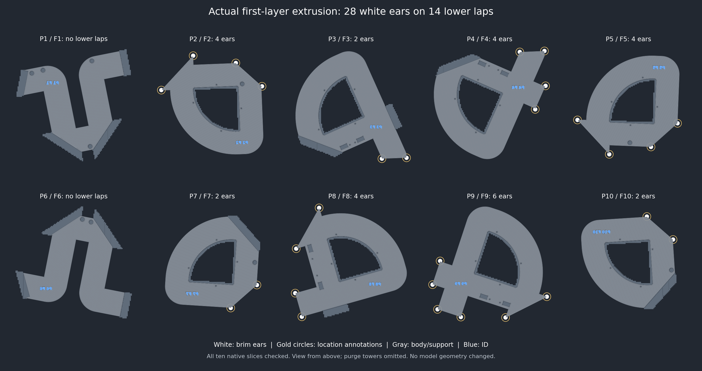

# Knot lower-lap brim ears — October 27, 2026

Historical corner-only revision. Superseded by the user's requested
[continuous white lower-lap brims](../knot-lower-lap-brims-r2/README.md).
The hashes and checks below describe r1, not the current root project.

Current production project: root **Knot.3mf**, Bambu Lab A2L, ten plates.

The user reported a lower-lap corner lifting on P4 and causing a failed print,
then authorized brim ears on the solid bottom laps on all plates. This is a
user-reported adhesion failure; the actual printed hash and printer were not
independently observed. The prior no-brim assessment did not establish physical
adhesion at these corners.

## Exact change

**brim_type: no_brim → brim_ears** (Bambu Studio's Painted mode). Add 28 native
brim points: two **12 mm diameter** ears at the actual first-layer free-end
corners of each of the **14 solid lower laps**. The saved bed-contact chamfer is
accounted for when locating the corners. No printable mesh is added or edited.
The ears occupy one **0.20 mm first layer**, use **white slot 1**, and keep the
saved **0.10 mm object gap**. The ordinary brim-width field remains 1 mm; native
painted points separately store their 6 mm radius.

P1 and P6 have only upper laps, so they receive no ears. The rest of every
part's perimeter stays brimless. All ten plates are freshly sliced.

Three P9 points slide slightly along the existing lower-lap contact edges to
keep the full nominal ear discs within the bed with at least 0.60 mm margin:

- P9 J12 right: 1.549 mm along the existing contact edge.
- P9 J14 left: 1.211 mm along the existing contact edge.
- P9 J14 right: 1.173 mm along the existing contact edge.

All object poses are preserved. Ear placement is stored in
`Metadata/brim_ear_points.txt` inside the project and survives native reopening.
The [native format](https://github.com/bambulab/BambuStudio/blob/master/src/libslic3r/Format/bbs_3mf.cpp)
uses object order, XYZ, radius and volume index; the points here use object
coordinates and volume index -1.

## Preservation and checks

- All original 3D archive entries are byte-identical: stock, keys, grooves,
  removed pads, material boundaries, support paint, labels and poses remain.
- All 28 solid-lap modifiers and 50 screw modifiers retain their geometry and
  settings. Bodies remain 8% gyroid; laps remain 100% rectilinear. The screw
  modifiers retain their Z12.4 caps. CAD/STL files are unchanged.
- Exterior wall paths, joint paths, colors, feature types and widths are
  identical. Native slicing changes **2 short upper shell-fill
  endpoints**, by at most **0.060083 mm**. These differences are
  recorded individually in `validation.json`; those segments are not claimed identical.
  Support interface/transition paths and first-layer support paths are identical.
  Complete support-path equality is recorded separately for each plate.
- All actual Brim extrusion is white at Z0.20 and lies within the selected
  lower-lap corner discs. Each of the 28 ears has more than 20 mm2 of commanded
  bead area and lies within 0.50 mm of its intended lap's actual mesh contact;
  exact measured distances are in `validation.json`. This is a toolpath check,
  not a physical adhesion measurement.
- All support base/body extrusion remains white; no blue support extrusion is
  present. First-layer blue model extrusion remains confined to the ID glyphs.
  All other first-layer outer walls are white. Five upper blue layers remain.
- White-first order, normal supports, infill-first off, 65 C Textured PEI bed,
  all material values, finish directions and the 2 mm purge-tower brim remain.
- All ten native slices, command-stream checksums, printable bounds, startup
  and purge-tower clearance pass. Native warnings are limited to the existing
  traditional-timelapse notice. The final project and all 28 painted points
  reopen natively with settings and geometry preserved.

Gold rings are annotations around the white brim extrusion, not printed paths.
The view is from above; underside IDs are intentionally mirrored. Purge towers
are omitted from this illustration, but included in the checks and estimates.

| Plate / part | Ears | White brim segments | Time | Material |
| --- | ---: | ---: | ---: | ---: |
| 1 / F1 | 0 | 0 | 8h 20m | 252.91 g |
| 2 / F2 | 4 | 810 | 7h 26m | 220.36 g |
| 3 / F3 | 2 | 333 | 9h 16m | 267.47 g |
| 4 / F4 | 4 | 805 | 9h 19m | 268.46 g |
| 5 / F5 | 4 | 700 | 7h 32m | 220.58 g |
| 6 / F6 | 0 | 0 | 8h 04m | 250.40 g |
| 7 / F7 | 2 | 323 | 7h 38m | 221.20 g |
| 8 / F8 | 4 | 762 | 9h 07m | 263.15 g |
| 9 / F9 | 6 | 1106 | 9h 05m | 265.52 g |
| 10 / F10 | 2 | 340 | 7h 39m | 221.47 g |
| **Total** | **28** | | **83h 26m** | **2451.52 g** |

Compared with the previous no-brim slice: **92 seconds**
and **0.25 g** added across all ten plates.
These are slicer estimates including supports and purge.

Physical ear adhesion, removal and full-size joint performance remain
unqualified. No printer job was sent.

Project SHA-256: `95e678abe97fe5f30dad2063d154214555ccd0646e9b3d6bfbbffdb1b94276d8`.
Source SHA-256: `8726fdcd42b2916d01b9656c698c738bc4ca536520af7e7abe5533f7d1d80bb6`.
