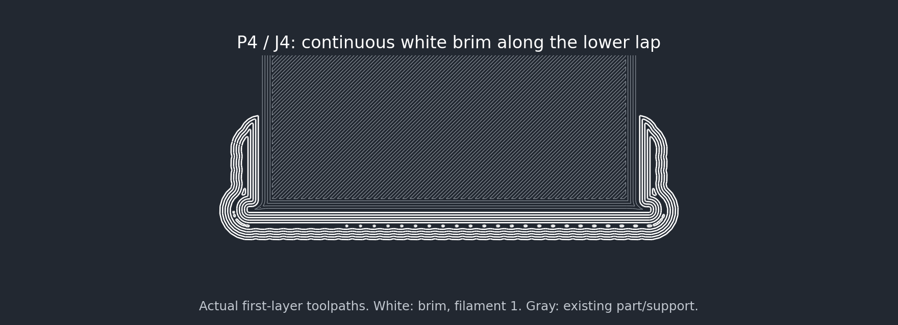
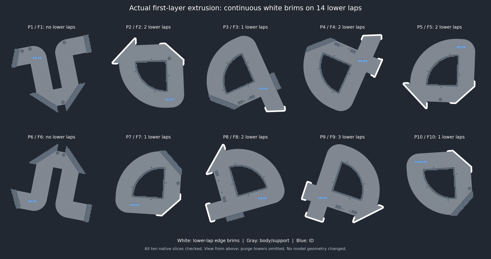

# Continuous white lower-lap brims — October 27, 2026

Current project: root **Knot.3mf**, Bambu Lab A2L, all ten plates freshly sliced.
This replaces the corner-only placement in r1 after the user reported that
brims only reached the corners and appeared blue.

## Changes

- Replace 28 isolated ears with **771 overlapping native painted
  points**, making continuous brims along the full free-end edges of all
  **14 solid lower laps**, wrapping around their corners and tapering along
  their side edges toward the shoulders. P1/P6 have only upper laps and receive
  no model brim; the rest of the part perimeter remains brimless.
- Painted radius is up to **6 mm** (roughly 5 mm of resulting outer brim),
  reducing to **2 mm** at the shoulders and as needed near the bed edge.
  No object moves. Local X0–2 is the tapered shoulder transition; the entire
  free-end edge and side edges from X2 to the tip are checked for coverage.
- Save explicit **first_layer_print_sequence = 1 3 2** on every plate.
  The matching global setting already existed. This per-plate setting is
  retained by native export and reopening, and keeps white slot1 first.
- Retain **brim_ears** mode, **0.10 mm object gap**, **0.20 mm first layer**,
  dormant ordinary brim width1 mm and the existing **2 mm purge-tower brim**.
  All global process/material settings remain byte-identical.

The prior stored G-code commanded white brims, but lacked the explicit plate
order in model metadata. The original screenshot's blue preview was not
independently reproduced: the computer-use helper returned an active-request
error through recovery attempts. This revision fixes the missing persisted
plate order and verifies actual native filament commands. It does not claim
that the screenshot was simply a display artifact.

The saved plate-order field follows Bambu's
[native project format](https://github.com/bambulab/BambuStudio/blob/master/src/libslic3r/Format/bbs_3mf.cpp)
and [plate configuration](https://github.com/bambulab/BambuStudio/blob/master/src/slic3r/GUI/PartPlate.cpp).

## Verification

- All ten fresh slices and the final project reopen natively. All painted
  coordinates and all ten custom plate orders survive the roundtrip.
- A separate native P4 diagnostic temporarily sets global order to Auto,
  keeping only the explicit plate order. It still commands white brims and
  white-then-blue on layer one. The diagnostic stays outside the production
  project; its proof is in `plate-order-isolation.json`.
- Every Brim extrusion is **white slot1** at **Z0.20** and remains inside the
  selected lower-lap edge regions. Full sampled edge coverage passes on all
  14 laps: maximum distance from checked edge to commanded brim bead is
  **0.091 mm**, with zero uncovered edge at a 0.70 mm search distance.
  This is spatial validation, not a physical adhesion measurement.
- All first-layer blue model extrusion remains confined to the existing ID
  glyphs. Other first-layer outer walls are white; five upper blue layers remain.
  Support base/body is white and no support feature uses blue.
- All original 3D archive entries are byte-identical: stock, joints, keys,
  grooves, all modifiers, IDs, material geometry, paint and poses remain.
  CAD/STL and all other production/sample projects retain their hashes.
- All model exterior walls, joint paths, colors and widths are preserved.
  Native upper shell-fill endpoint changes are recorded individually, with
  maximum displacement **0.060083 mm**. Complete support hatch equality
  is recorded per plate; support interface/transition and first-layer support
  paths remain identical.
- Checksums, printable bounds, startup/purge-tower clearances and locked
  process constants pass. Native warnings contain only the existing
  traditional-timelapse notice. No printer job was sent.

White highlights actual Brim paths; existing model/support paths are shown in
gray for contrast. Blue paths in the overview are the underside identifiers.

| Plate | Lower laps | White brim segments | Time | Material, g |
| --- | ---: | ---: | ---: | ---: |
| 1 | 0 | 0 | 8h 20m | 252.91 |
| 2 | 2 | 3188 | 7h 27m | 220.67 |
| 3 | 1 | 870 | 9h 16m | 267.56 |
| 4 | 2 | 2695 | 9h 20m | 268.65 |
| 5 | 2 | 3124 | 7h 33m | 220.89 |
| 6 | 0 | 0 | 8h 04m | 250.40 |
| 7 | 1 | 1910 | 7h 39m | 221.33 |
| 8 | 2 | 3034 | 9h 09m | 263.42 |
| 9 | 3 | 4313 | 9h 06m | 265.88 |
| 10 | 1 | 1930 | 7h 39m | 221.61 |
| **Total** | **14** | | **83h 33m** | **2453.33** |

Compared with the isolated-ear slice: **475 seconds**
and **1.81 g** added across ten plates.
Estimates include supports and purge.

Physical adhesion, removal and full-size performance remain unqualified.
Photo-rabbet support/speed settings are unchanged by this brim correction.

Project SHA-256: `2a02b0b67f6d4007ba0a60d5737afc122895d4d90c560be25bad95537ed964ea`.
Source SHA-256: `95e678abe97fe5f30dad2063d154214555ccd0646e9b3d6bfbbffdb1b94276d8`.
