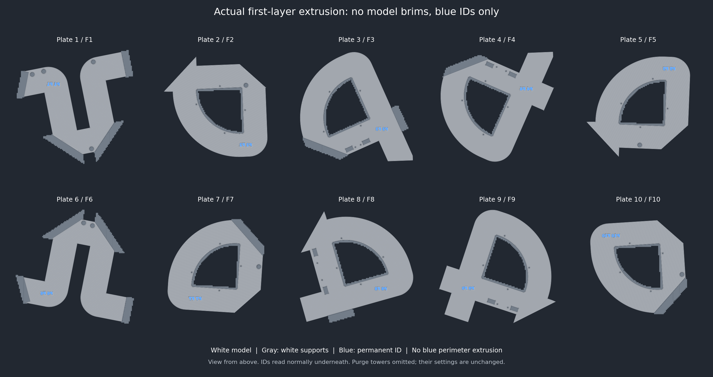

# Knot model brims removed — October 26, 2026

Current production file: root **Knot.3mf**, A2L, ten plates.

The user reported difficult brim cleanup, requested removal if unnecessary,
commit/push, and pointed out a blue outline in a first-layer preview. They
confirmed that preview came from the repository's Knot.3mf.

## Decision and exact change

The bodies are only **13.5 mm tall** and each has **36952–49592 mm2** of bed
contact. The smallest separate contact island is **18406 mm2**. These are broad,
low PLA bodies on the saved **65 C Textured PEI** plate, rather than tall parts
depending on small feet. Removing their narrow 1 mm adhesion brims is a reasonable
tradeoff for easier cleanup. This is a geometry-based assessment, not physical
proof against corner lifting. Brimless adhesion remains unqualified.

[Prusa's brim guidance](https://help.prusa3d.com/article/skirt-and-brim_133969)
explains that brims increase contact area, particularly for tall objects with a
small base and groups of small objects, and suggests at least 3 mm for useful
additional adhesion. The measured contact areas here are from the actual saved
production meshes at Z0.1, not estimates from a screenshot.

Only **brim_type: outer_only → no_brim** changes. Dormant brim width/gap remain
1/0.1 mm. All supports, their paint and spacing, white base material, interface
Auto, white-first filament order, **2 mm purge-tower brim**, geometry, material
regions, blue IDs and upper blue trim, CAD/STLs and every other saved setting
remain unchanged. No new adhesion devices or geometry are added.

## Native validation

All ten plates have fresh native slices and final native reopening.

- **Zero Brim extrusion** and zero Skirt extrusion on every plate.
- Every first-layer blue model centerline is inside the exact ID glyphs, with
  zero centerline length outside. Nominal bead footprints remain within 0.05 mm
  of the glyphs, allowing the slicer's rounded-corner/width approximation.
  There are **no blue first-layer part-outline extrusion commands**.
- All first-layer outer-wall segments away from the label use white slot 1.
  Blue on the separate purge tower remains necessary and is excluded from the
  illustration. Labels retain their exact source paths and backing.
- All model path geometry, filament assignments, feature types and widths match
  the preceding release exactly, including all upper-layer artwork and joints.
- Support base/body remains white. No blue appears in support, interface or
  transition extrusion. Contact paths and first-layer support paths are identical;
  complete support equality is separately recorded per plate.
- Original 3D archive entries, stock, poses, object/volume settings and paint
  remain intact. All adjacent CAD/STL and other production projects are unchanged.
- G-code configuration changes only in brim_type; checksums, bed/tower clearance,
  native warnings and reopening pass. Only the existing timelapse notices remain.

| Plate / part | Bed contact cm2 | Brim segments | Blue ID segments | Time | Material |
| --- | ---: | ---: | ---: | ---: | ---: |
| 1 / F1 | 371.5 | 0 | 148 | 8h 20m | 252.96 g |
| 2 / F2 | 410.6 | 0 | 271 | 7h 26m | 220.29 g |
| 3 / F3 | 439.7 | 0 | 434 | 9h 16m | 267.46 g |
| 4 / F4 | 463.3 | 0 | 169 | 9h 18m | 268.40 g |
| 5 / F5 | 408.6 | 0 | 346 | 7h 31m | 220.51 g |
| 6 / F6 | 374.8 | 0 | 445 | 8h 05m | 250.43 g |
| 7 / F7 | 369.5 | 0 | 139 | 7h 38m | 221.20 g |
| 8 / F8 | 470.9 | 0 | 559 | 9h 07m | 263.10 g |
| 9 / F9 | 495.9 | 0 | 447 | 9h 04m | 265.46 g |
| 10 / F10 | 369.6 | 0 | 457 | 7h 39m | 221.45 g |
| **Total** | | **0** | | **83h 24m** | **2451.26 g** |

## Blue preview outline

The previous saved file also had no blue first-layer outline extrusion: its model
paths are identical to this revision, and its brims were white. The visible edge
in the screenshot is therefore not represented by a blue extrusion around the
part in the checked saved command stream.

The local Bambu preference **Always show shells in preview** is enabled
(`show_shells_in_preview = true`). Bambu's
[preview renderer](https://github.com/bambulab/BambuStudio/blob/master/src/slic3r/GUI/GCodeRenderer/BaseRenderer.cpp)
can overlay transparent model geometry separately from G-code extrusion. This is
a plausible explanation for the screenshot, not a visually confirmed diagnosis.
The computer-use helper failed to launch Bambu with
`accessibility window-opened handler did not become ready`; native command-line
slicing/reopening worked. No local preference was changed. To inspect extrusion
alone, turn off **Always show shells in preview** in Preferences and reslice;
the [preference definition](https://github.com/bambulab/BambuStudio/blob/master/src/slic3r/GUI/Preferences.cpp)
specifies that reslicing is needed after changing it.

`preview-investigation.json` records this distinction. Digital checks do not
establish physical adhesion, support cleanup, label finish or full-size fit.
No printer job was sent.

Project SHA-256: `8726fdcd42b2916d01b9656c698c738bc4ca536520af7e7abe5533f7d1d80bb6`.

Source SHA-256: `d7fba1c2820d34181bf1a9f5828c8b499b3969ab59fee15016c830cadd4d3c74`.

See `provenance.json`, `validation.json`, `native-result.json` and
`native-reopen.json` for source identity, preservation and per-plate checks.
Earlier release records retain their historical hashes.
Run `python scripts/audit_root_projects.py` after pulling.
