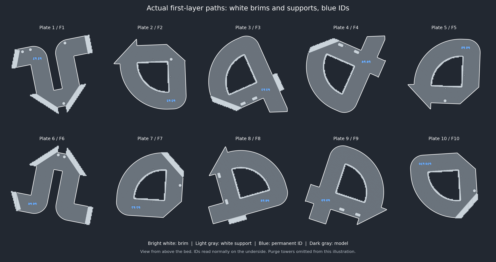

# Knot white tear-away brims — October 25, 2026

Current project: root **Knot.3mf**, Bambu Lab A2L, ten plates.

The user observed that the removable perimeter was still blue after the support
base correction. This perimeter is the **Brim** feature. The preceding release
assigned every brim segment to blue slot 3 on all ten plates. Support-color checks
did not cover brims; this revision checks both explicitly.

The only saved setting change is **first_layer_print_sequence: Auto [0] →
[1, 3, 2]**, white first, then blue, then wood if present. Actual first-layer
extrusion uses white then blue on all ten plates. Other-layer order remains Auto.
Brim width **1 mm**, object gap **0.1 mm** and **outer_only** mode are unchanged.
Support base stays explicitly white slot 1; its interface selector stays Auto.
The blue **P1 F1 through P10 F10** labels and five blue top layers remain intact.

## Native checks

All ten plates were freshly sliced and the final project reopened natively.

- Every Brim extrusion uses **white slot 1**. No skirt extrusion is present.
- All support base/body extrusion uses **white slot 1**. There is no blue
  Support, Support interface or Support transition extrusion. Existing interface
  and transition material assignments remain unchanged.
- All model segment geometry, feature types, widths and material assignments
  are identical to the source, including first-layer IDs and upper skins.
- Support interface/transition paths and first-layer support bed-contact paths
  remain exactly identical. Native support-body hatch paths above layer one
  regenerate with the new ordering; these are not claimed identical.
- Brim loop start positions can move. Width and height are identical; the full
  outline agrees within **0.001 mm**, the coordinate rounding of the G-code,
  and total outline length differs by less than **0.01 mm** per plate. Maximum
  measured outline difference: **0.000673 mm**.
- All original 3D archive entries are byte-identical; object/volume settings,
  support paint, poses, material boundaries, label STLs and CAD remain unchanged.
- Every G-code configuration differs only in first_layer_print_sequence.
  Checksums, printable bounds, startup/tower clearance and native reopening pass.
  No unexpected native warning is reported. Purge towers retain their necessary
  color changes and are excluded from the illustration above.

| Plate / part | White brim segments | Blue ID segments | Time | Material |
| --- | ---: | ---: | ---: | ---: |
| 1 / F1 | 294 | 148 | 8h 21m | 253.17 g |
| 2 / F2 | 404 | 271 | 7h 26m | 220.50 g |
| 3 / F3 | 332 | 434 | 9h 16m | 267.64 g |
| 4 / F4 | 450 | 169 | 9h 19m | 268.62 g |
| 5 / F5 | 368 | 346 | 7h 32m | 220.72 g |
| 6 / F6 | 303 | 445 | 8h 05m | 250.64 g |
| 7 / F7 | 312 | 139 | 7h 39m | 221.35 g |
| 8 / F8 | 419 | 559 | 9h 08m | 263.33 g |
| 9 / F9 | 477 | 447 | 9h 05m | 265.72 g |
| 10 / F10 | 336 | 457 | 7h 39m | 221.61 g |
| **Total** | | | **83h 30m** | **2453.28 g** |

Times and material are slicer estimates including supports and purge.
Physical brim removal, label finish, durability and full-size fit remain
unqualified. No printer job was sent.

Project SHA-256: `d7fba1c2820d34181bf1a9f5828c8b499b3969ab59fee15016c830cadd4d3c74`.

Source SHA-256: `9fe693f6b5b6ebfc363ecaada107172337c0fd962a80d956ed5fc8fd90dc5427`.

Exact hashes, setting differences, per-feature material checks and native results
are in `provenance.json`, `validation.json`, `native-result.json` and
`native-reopen.json`. The preceding support-base and label reports retain their
historical hashes. Run `python scripts/audit_root_projects.py` after pulling.
