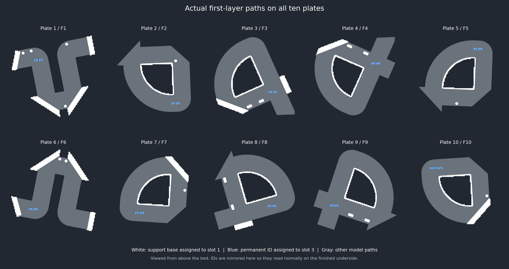

# Knot white support bases — October 25, 2026

Current production: root **Knot.3mf**, Bambu Lab A2L, ten plates.

The user observed blue supports after the first-layer labels were added and
explicitly approved fixing the support base to white, reslicing all ten plates,
verifying support colors, and committing/pushing to main.

The sole saved setting change is **support_filament: 0 (Auto) → 1 (white)**.
**support_interface_filament stays 0 (Auto)**. The existing **P1 F1 through
P10 F10** labels remain blue slot 3 in Z0–0.20 mm, 8 mm tall and underside-readable.
Original stock, all modifiers, material profiles, poses, support paint, normal
support type, gaps, interface spacing, density, patterns and all other saved
settings remain unchanged. All CAD and STL files are byte-identical.

## Actual native command checks

All ten plates have fresh native slices and native reopen verification.
Every positive support extrusion is classified by its actual tool selection:

- Every **Support** base/body segment uses **slot 1 white**, including layer one.
- **No blue extrusion** appears in Support, Support interface or Support transition.
- Actual interface filament slots across the project: **1, 2**;
  the selector remains Auto. Detailed per-feature, per-slot layer lists are in
  `validation.json`.
- Each blue label has the same model extrusion segments as the preceding release.
  All model segment geometry, filament assignments, feature types and widths
  match the source on every layer, including labels, solid laps and upper skins.
- Support interfaces/transitions retain their exact path geometry, widths and
  material assignments. First-layer support bed-contact paths retain their exact
  geometry/widths with white replacing blue. Native support-body hatch paths
  above that layer are regenerated for the explicit white assignment; they are
  not claimed identical. Saved density, support pattern, gaps and all other
  parameters remain unchanged, and no floating-region warning is reported.
- The earlier release did contain blue base support at Z0.20 on all ten plates.
  The previous model-path verification excluded support features and missed this
  material assignment. This revision checks all three support feature classes.
- The parser checks indented startup tool commands, leading-decimal extrusion,
  relative/absolute extrusion, retractions and special non-filament T commands.
  A focused regression fixture verifies the indentation/decimal cases.
- All G-code configurations differ only by support_filament; checksums, bed/tower
  clearances including support and brim, source geometry/settings preservation
  and the final native reopen pass. No unexpected native warnings remain.

Counts below are actual first-layer extrusion segments, not separate objects.

| Plate / part | White support segments | Blue label segments | Time | Material |
| --- | ---: | ---: | ---: | ---: |
| 1 / F1 | 1704 | 148 | 8h 19m | 252.79 g |
| 2 / F2 | 1468 | 271 | 7h 25m | 220.16 g |
| 3 / F3 | 2478 | 434 | 9h 14m | 267.28 g |
| 4 / F4 | 2259 | 169 | 9h 17m | 268.27 g |
| 5 / F5 | 1488 | 346 | 7h 30m | 220.38 g |
| 6 / F6 | 1546 | 445 | 8h 03m | 250.28 g |
| 7 / F7 | 1906 | 139 | 7h 37m | 220.98 g |
| 8 / F8 | 2159 | 559 | 9h 06m | 262.97 g |
| 9 / F9 | 1712 | 447 | 9h 03m | 265.34 g |
| 10 / F10 | 1913 | 457 | 7h 37m | 221.26 g |
| **Total** | | | **83h 13m** | **2449.70 g** |

Times/material are slicer estimates including supports and purge. Digital checks
do not establish physical support removal, label finish or full-size fit.
No printer job was sent.

Project SHA-256: `9fe693f6b5b6ebfc363ecaada107172337c0fd962a80d956ed5fc8fd90dc5427`.

Source SHA-256: `b33d28f0fc7277758928321a09196929a53d5c63b5503548a51b408cb4f6e626`.

`provenance.json`, `validation.json`, `native-result.json` and
`native-reopen.json` record the exact source/change, per-plate colors and checks.
Earlier first-layer-label evidence remains a historical source record.
Run `python scripts/audit_root_projects.py` after pulling.
