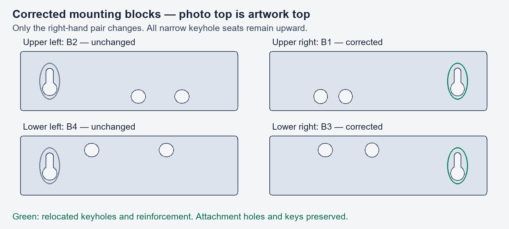

# Current wall-block correction

The user confirmed that the top of the supplied photo is the artwork's top.
Only B1 (photo upper right, F3) and B3 (photo lower right, F9) need replacement.
Use root `Small Parts.3mf`, plate 3. That plate also retains B2/B4 and the
32 photo retainers; its stored slice prints the complete plate. Select only
B1/B3 and reslice in Bambu Studio if printing just the replacements.

Both corrected keyholes move from local X+51 to X-51 mm. Their existing
entry openings, retaining lips and hidden head channels are transplanted
exactly; their solid modifiers move with them. Slot direction remains upward
(entry Y-5, seat Y+6). B2/B4, attachment bores, locating keys, outlines,
object poses, all process/material settings and unrelated geometry are preserved.

The four blocks are pictured in the same arrangement as the user's photo:

Geometry differences are confined to the old/new keyhole cavities and moved
reinforcement. Both replacement bodies are watertight, with unchanged volume.
Native plate 3 slicing, project reopening, G-code checksum, object identifiers,
locked constants and CAD/catalog synchronization pass. Plates 1/2/4/5 retain
their original G-code bytes. Other root projects are unchanged.

`geometry.json` records the original source hash and geometry checks;
`validation.json` records the current project hash and native results.
The temporary 90-degree revision in `../wall-keyholes-r2/` is withdrawn.
Replacement blocks have not yet been physically printed or tested.
