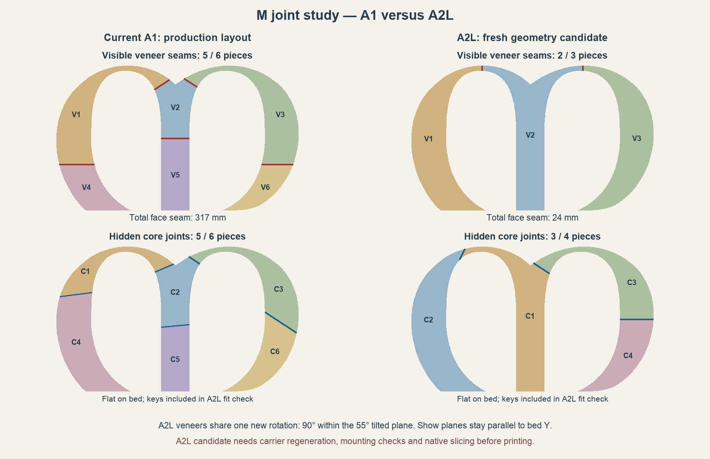

# M joint impact: A1 versus A2L

A fresh partition and a **new shared veneer orientation** give the A2L a substantially cleaner candidate: **three hammered veneers with two short visible seams**, compared with six veneers and five visible seams in the current A1 project. A separate flat-core study supports four structural sections instead of six.

| M construction | Current A1 | A2L candidate | Change |
| --- | ---: | ---: | ---: |
| Flat core sections | 6 | 4 | 2 fewer |
| Hidden core joints | 5 | 3 | 40% fewer |
| Hammered veneer panels | 6 | 3 | 3 fewer |
| Visible veneer seams | 5 | 2 | 60% fewer |
| Total visible seam length | 316.9 mm | 24.3 mm | 92.3% less |
| Core plus veneer pieces | 12 | 7 | 5 fewer |

Colors distinguish pieces; every veneer still prints in the same copper silk. Red lines show visible veneer seams; blue lines show hidden core joints. Both layouts use the same artwork scale. These counts are separate from the A2L study's **fourteen knot joints**.

Seam lengths are front-view projections through the continuous artwork; the textured 3D edges have slightly longer paths.

## The cosmetic change

The new left and right veneers contain their entire sweeping curves. The middle veneer contains the full central stem, fork and inner portions of both arches. Two cuts cross the narrow arch crowns at assembly X=-125 mm and X=125 mm. Each seam is about **12.1 mm long**. Both outer leg seams and the central stem seam disappear.

The original A1 has 44.6 mm and 38.7 mm fork seams, 86.4 mm and 78.0 mm outer sweep seams, and a 69.2 mm central stem seam. The A2L candidate replaces those five seams with just the two short crown seams. It still needs accurate closure, but the visible length to fit and match drops by about 293 mm.

## One consistent orientation for every veneer

Rotate **all three veneers together by 90 degrees within the existing tilted show plane**. Keep the current 55-degree lean and the same face normal. The show planes still contain bed Y, which preserves the requested bed-slinger alignment. Every panel receives exactly the same full rotation; none receives an independent packing yaw. The texture must continue to use one global hammer field across the cuts, with zero nominal cosmetic gap.

In this orientation, assembly Y becomes the main rising direction in printer Z. Each complete sweep spans approximately 358.7 mm in assembly Y and rises to approximately **299 mm including its bed elevation**. This is what the A2L's extra height makes possible. The A1's 256 mm height cannot accept these panels in this pose.

The locally installed profiles give the A2L a **330 × 320 mm area and 325 mm height**, matching [Bambu's announcement](https://blog.bambulab.com/bambu-lab-a2l-creative-playground-extra-large/). Profile paths and hashes are recorded in [evaluation.json](evaluation.json).

| Candidate veneer | Reserved X × Y × Z envelope, mm |
| --- | --- |
| V1, full left sweep | 215.1 × 189.2 × 298.6 |
| V2, central stem/fork/inner arches | 215.1 × 256.0 × 298.6 |
| V3, full right sweep | 215.1 × 193.3 × 298.6 |

These bounds assume the entire 4.1 mm veneer thickness everywhere, allow 3 mm per XY side for carrier/brim/support roots, and include a 2.4 mm bed elevation. A further 2 mm per bed edge and 2 mm height are reserved when checking the machine envelope. **Actual new fin carriers and native trees have not been generated or sliced.** This establishes geometric feasibility, not a ready-to-print release.

The approximately 299 mm tall prints need well-braced bonded fins and direct bed anchoring. The fins and starter shoes must follow the new rising direction, starting under the arch crowns. The current carrier generator assumes assembly X rises and contains A1-specific 256/260 mm bounds; it must be adapted rather than reused unchanged. Taller printing may increase support consumption, time and movement sensitivity, so this study makes no savings claim for those quantities.

All three replacement veneers need the new shared orientation. Existing veneers from the A1 pose should not be mixed into this face without checking reflection.

## Flat cores and hidden joints

A fresh core partition moves the left structural joint near the upper sweep, offsets the right fork joint 15 mm from its old location, and places the remaining right leg joint at Y=0. This produces four cores with three hidden interfaces. All three face seams from the existing legs/stem are removed in the new veneer layout; core and veneer joints remain staggered.

The core bed check includes actual planar **18 mm mushroom-key outlines**, 6 mm head radii, 7 mm neck widths, 0.15 mm socket relief, and at least 3 mm of artwork outside each head. Short seams use one key; the long right leg seam uses two. Keyed outlines remain connected polygons without loose socket fragments.

The largest keyed core is **325.28 × 315.30 mm** at about 107.54 degrees on the bed. A 1 mm brim leaves approximately **1.35 mm free per side** when centered, so native bead-inclusive checking is particularly important here. The flat cores can rotate independently; veneer rotations remain locked together.

Fewer hidden interfaces means less alignment and gluing. It does **not** establish higher strength: the relocated upper joint has different local geometry and one key. The bonded veneer crossing it may distribute load, but that requires physical confirmation. The cosmetic benefit does not require adopting four cores: the three-panel face could also be developed over the six-core backing, with matching seating pockets.

## Alternative that keeps the current complete rotation

If the existing full veneer rotation is kept exactly, a separately checked candidate has **five veneers and four visible seams**, totaling approximately **220 mm**. Its longer lower sweeps use the A2L's extra bed Y length. It is saved as `a2l_current_pose_alternative` in [evaluation.json](evaluation.json).

The three-panel option is the stronger cosmetic proposal because it changes the common orientation of the whole set while preserving consistent reflection and Y-parallel show planes.

## Before adopting the candidate

- Regenerate matching 3D veneers, seating pockets, pads/locators as needed, and bonded fin carriers. Preserve global texture phase and zero-gap face boundaries.
- Check mounting features against the real keys, pockets and surrounding material. Existing M dowel 3 is about 7.3 mm from the candidate core seam and needs particular attention. Coordinate with hardware changes required by the fourteen-joint A2L knot layout.
- Native-slice every new part using A2L profiles. Verify actual brims, tree feet, extrusion width, fin connectivity, height, hardware clearance and assembly order.
- Physically check seam closure, flatness, silk reflection, tall-panel support behavior and the narrow upper core joint.

These are **geometry candidates, not proven global minima**. The A1 comparison uses the current production layout. The main A1 project and all samples remain unchanged. A2L part numbers in this diagram belong only to this study.

Reproduce the evaluation with [analyze_a2l_m_joints.py](../../../scripts/analyze_a2l_m_joints.py), using the project's geometry dependencies. Exact cuts, both common rotations, keyed footprints, seam lengths, hardware distances, fit assumptions and source identities are saved in [evaluation.json](evaluation.json).
