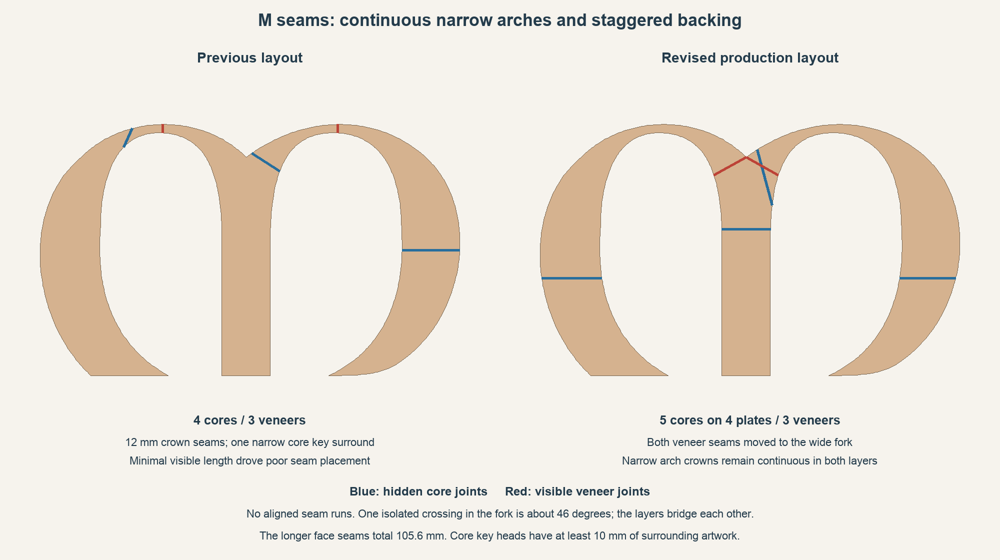

# A2L M: staggered joints away from the narrow arches

The production revision uses five flat structural cores and three flat-backed veneers. Both narrow arch crowns stay continuous in both layers. The earlier 12 mm crown cuts and narrow core-key surround are superseded.

The two visible veneer seams cross the broad central fork and total 105.6 mm in front projection. This is longer than the superseded 24.3 mm crown solution. Avoiding joints in the slender arches takes priority over minimizing seam length.

The four hidden core joints lie in the fork, stem and broad lower sweeps. None has an aligned run beneath a veneer seam. One isolated crossing is about 46 degrees; nearby seam directions must differ by at least 40 degrees. The core joints are at least 18 mm apart. The 18 mm mushroom keys have at least 10 mm around each head, and heads stay at least 8 mm from face seams.

All five cores print flat at 8% gyroid. C1/C2 upper sections use plates 11/12, C3 stem uses plate 13, and C4/C5 lower sections share plate 14. Veneers V1/V2/V3 stay on plates 15-17. The project still has 20 plates; the knot and accessory plates retain their previous geometry and toolpaths. All ten M screw and eight frame-pin positions are retained.

The three veneers share the same complete 55-degree print rotation, with the show planes along bed Y. Their removable carriers retain separate grounded ribs, recessed cut necks and 3 mm rear access. Surface texture and zero-gap face closure are preserved.

The specification is [staggered-layout.json](staggered-layout.json). Regenerate the M with `scripts/repartition_a2l_M.py plan`, `scripts/build_a2l_project.py M`, and `scripts/repartition_a2l_M.py package`; validate geometry and native slices before publishing. The comparison report is [evaluation.json](evaluation.json), and production checks are [M-joint-layout-validation.json](../../bambu/Dara-Photo-Frame-A2L/M-joint-layout-validation.json).
