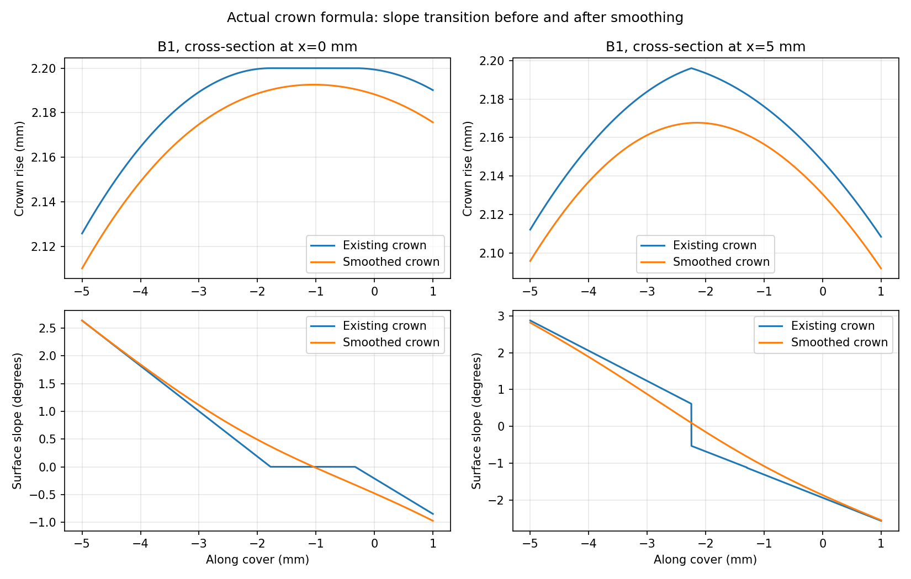

# Cover crown crease correction — 2026-10-15

The latest bevel-only file still shows the aligned notches reported by Zach.
The crown formula itself has a geometric defect: it uses the distance to the
nearest M-outline edge. Where that edge changes, a narrow stroke can have a
sharp medial ridge. Elsewhere the capped crown transitions onto a flat plateau.
Checking mesh deviation from that same formula did not test its smoothness.

At B1 local x=5 mm, the analytical profile has a slope jump near y=-2.244 mm.
The original outer-wall G-code has its largest measured interior direction
change near the same ridge (x=3.665, y=-1.822 mm). This establishes a real shape
discontinuity in the relevant region. It does not prove that every preview dash,
or all damage in the physical print, has the same cause.

The graph uses an enlarged vertical scale. The replacement show face uses a
1.5 mm Gaussian smoothing radius (standard deviation), sampled at 0.125 mm and
interpolated with a C2 bicubic spline. Signed-distance continuation outside the
outline avoids introducing a lip at the edge. The existing underside, footprint,
glue allowance and M seats are preserved. The existing 0.25 mm rim bevel remains.

All five corrected covers are single watertight solids. Sampled show-face changes
are below 0.033 mm, minimum thickness remains above 0.93 mm including the bevel,
and bidirectional underside checks differ by less than 0.000063 mm.
[Geometry measurements](geometry.json).

The new [Dara-Cover-Smooth-Crown-Test.3mf](../../../Dara-Cover-Smooth-Crown-Test.3mf)
is labeled **B1 SMOOTH CROWN** and contains one full-size B1 with native supports:
**2.08 g / 24 min 25 sec**. Orientation, process, support eligibility and seat are
retained from the bevel-only file; the recentered mesh and native support paths
are regenerated. Its analytical crown no longer has the slope jump. Native
extrusion paths are still finite segments; smaller segment direction changes
remain and their magnitude alone does not prove a smooth physical finish.

The Bambu native slice checks geometry round trips, painting, underside support
interfaces, tree bases, motion commands, bounds, filament and checksums.
[Slice validation](validation.json). The first CLI invocation wrote outputs but
exited abnormally; a fresh second invocation exited successfully and its output
passed these checks. Interactive Bambu preview and physical finish remain to be
confirmed. No print was started.

Rebuild with `scripts/prepare_cover_crown_test.py geometry`, `stage`, `slice`, and
`verify`. `scripts/prepare_hammered_bands.py` also uses the new show-face function
when regenerating production covers; M seats still use the original crown.
