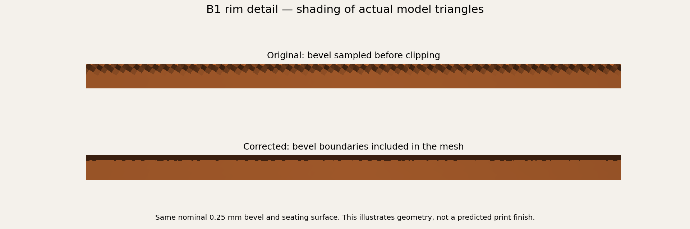
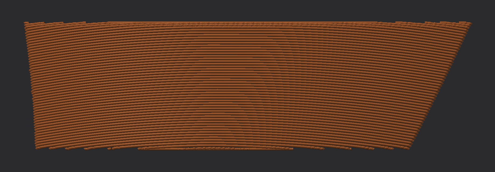
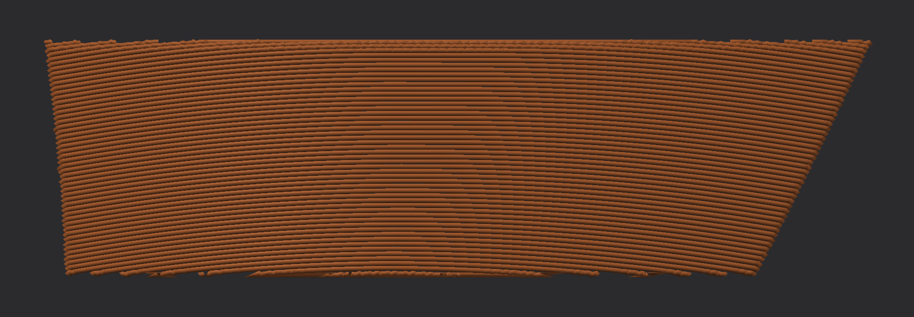

# Cover investigation and bevel repair — 2026-10-15

**A real rim defect is repaired in the model. The separate scar across the physical cover is still unexplained.** Zach confirmed that the supports touched the opposite face, ruling out direct support contact on the scarred face. Rotating the earlier cover did not eliminate the physical scar.

The corrected B1 is [Dara-Cover-Edge-Test.3mf](../../../Dara-Cover-Edge-Test.3mf), one full-size cover, **2.11 g / 23 min 54 sec**, with a saved native Bambu slice. This is an optional test of the edge repair, **not a confirmed cure for the transverse scar**. The complete Dara project and previous tests are unchanged. No print was started and Bambu's interactive window was not opened for this repair.

## What was wrong with the mesh

The generator defined a 0.25 mm bevel, sampled it on a 0.25 mm grid, and then clipped it to the cover footprint. The narrow bevel could fall between grid points. Clipping the already interpolated height field left repeating scallops along the edge.

The generator now includes both edges of the bevel in the triangulation before evaluating their heights. It refines triangles around corners where the nearest boundary changes. The nominal outline, crown, bevel dimensions, band thickness and underside seat formula remain the same.

Measured at triangle centers and edge midpoints, B1's maximum deviation from the intended top formula fell from **0.13163 mm to 0.00100 mm**. All five regenerated bands pass the same sampled 0.001 mm limit and are single watertight solids. This limit is a sampling check, not a mathematical bound at every possible point. Bidirectional underside vertex/face-center checks against the original underside triangles differ by at most **0.000115 mm**; this is numerical tessellation variation, not a changed glue allowance. [Geometry measurements](geometry.json).

Only B1 has been packaged as a new print file. The generator correction also covers B2–B5, but the existing full-project binaries have not been replaced while the cover finish remains unresolved.

## What the dark Preview dashes do and do not establish

The white markers are ordinary seams at the edge. The smaller dark dashes on the broad face are a different issue. The inspected central face paths contain connected extrusion segments, with no retraction or path break at those joins. Scarf seams are disabled. A watertight mesh alone would not have established this.

Bambu's [AdvancedRenderer](https://github.com/bambulab/BambuStudio/blob/master/src/slic3r/GUI/GCodeRenderer/AdvancedRenderer.cpp) draws each extrusion segment as a separate prism, with corner filler triangles and interpolated normals. Its [vertex shader](https://github.com/bambulab/BambuStudio/blob/master/resources/shaders/140/gcode.vs) constructs those cross sections. The installed vertex and fragment shader text matched the inspected public source after newline normalization.

The images below are **standalone reconstructions, not Bambu screenshots and not physical extrusion simulations**. They use the same 4,685 captured outer-wall segments from the unchanged precision test. Changing only the rendering of joins removes the small central notch track. This demonstrates a rendering mechanism for similar marks; it does not prove every mark in Zach's screenshot has that cause or explain the scar on the printed object.

Separate segment prisms and normals:

Same paths with shared mitered joins and normals:

The earlier arc-join angle comparison did **not** establish a cause or cure. There is no justified angle threshold that proves a smooth print. The precision test remains historical evidence and is no longer recommended as the likely remedy merely because it changes those angles. The captured paths and their source G-code hash are in [renderer-paths.json.gz](renderer-paths.json.gz); [render_cover_path_joins.py](../../../scripts/render_cover_path_joins.py) reproduces these diagnostic views.

## Saved print and validation

Compared with the earlier cover-only precision test, the new file changes the bevel mesh, regenerates its support paint and support paths, and recenters the revised solid. It retains the slicing settings, object overrides, 55-degree tilt and face plane along Y. Arc fitting remains off and resolution remains 0.001 mm to avoid changing another variable in this comparison.

Native slicing verifies one B1, copper slot 1, A1 / 0.4 mm nozzle / textured PEI, supports and interfaces under the glue face, a bed-contacting tree base, in-bed paths, no inspection pause, and the existing X/Y motion limits. Mesh round-trip deviation is under 0.000016 mm. The full Dara, its duplicate, the copper candidate, the three-piece band test and the earlier precision test retain their recorded hashes. [Slice validation](validation.json).

If this optional cover is printed, assess the rim and middle scar separately. A cleaner edge would validate the geometric repair; it would not prove the middle scar was caused by the bevel. An unchanged middle scar leaves that issue unresolved. No full-set cover reprint is recommended from the current evidence.

Reproduce with `scripts/prepare_cover_edge_test.py geometry`, `stage`, `slice`, then `verify`, using the installed Bambu CLI and existing geometry dependencies. `geometry` rebuilds and checks all five covers; `verify` publishes only the isolated B1 file.
