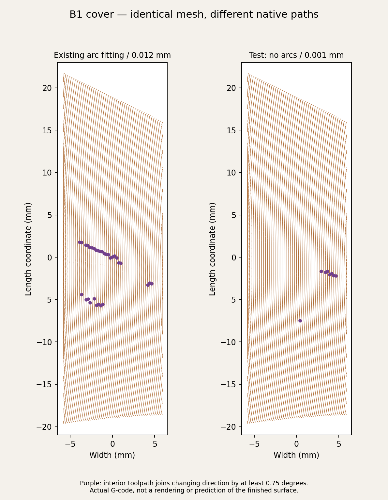

# B1 cover precision investigation — 2026-10-15

**Historical experiment — superseded assessment:** The arc-join measurements below did not establish the cause or cure of the physical scar. Subsequent inspection reproduced similar Preview dashes through segment rendering without extrusion gaps, and found a separate modeled bevel defect. See the [current investigation and optional bevel-repair file](../cover-edge/README.md). Do not treat the former "next experiment" recommendation below as current guidance.

Zach reported the same transverse scar on a cover printed in two orientations, plus a visible line in Bambu Preview. The show-face appearance remains unapproved. The repeated scar is evidence against treating this only as an A1 bed-motion problem; it does not establish a broken mesh.

The earlier experiment is preserved as [Dara-Cover-Only-Test.3mf](../../../Dara-Cover-Only-Test.3mf): **one existing full-size B1, 2.11 g and 24 min 29 sec**. [Instructions](../../../Dara-Cover-Only-Test.txt). The complete project has not been changed by this investigation.

## Evidence and limits

- B1 extracted from the saved test is a single watertight solid, with 33,570 triangles. Its assembled mesh matches the generated original within approximately 0.000011 mm. Inspecting its height and normals did not reveal a hole or abrupt step matching the physical scar. Topological checks alone do not prove surface quality.
- The native outer-wall G-code has chains of circular-arc junctions across the face. At those junctions the commanded direction changes slightly. The plot below measures these changes in the same region for identical geometry and orientation.
- Removing arcs alone at the existing 0.012 mm simplification tolerance increased the largest interior direction change in the comparison from 1.29 to 3.11 degrees. The delivered test removes arcs **and** uses a 0.001 mm tolerance; the measured maximum is 0.96 degrees. These are geometric measurements, not predictions of physical acceleration or print quality.
- The original pre-Y-orientation slice was also examined and has a chain of arc joins across the face. The photo and Preview make these joins a reasonable suspect, but the causal link to the physical scar is **not confirmed**. The separate rough edge is not explained conclusively either.

The plotted 0.75-degree marker threshold is a visualization choice, not a pass/fail surface-quality limit. Smaller direction changes remain in the test because its curved surface is represented by finite line segments.

## Delivered test

Only `enable_arc_fitting` (1 → 0) and `resolution` (0.012 → 0.001 mm) change the slicing process. The cover is isolated and centered; its shape, seating dimensions, 55-degree tilt, face plane along Y, support painting, filament settings, layer height and motion caps are retained. The mesh survives native export within 0.0002 mm, and support-paint counts match. Native G-code verifies zero model-extrusion arcs, supports and interfaces, a bed-contacting tree base, support interfaces below the glue face, positive print heights, in-bed bounds, copper slot 1, and no inspection pause. Startup/travel arcs may remain.

The 32-plate normal project, its duplicate, seven-plate copper candidate and previous three-piece test retain their original hashes. Their cover settings have **not** been promoted from this experiment. This file is retained for comparison, not recommended as the likely remedy.

[Full measurements, preserved hashes and toolpath checks](validation.json). Reproduce with `scripts/prepare_cover_precision_test.py stage`, then `slice`, then `verify`. Slicing uses the installed Bambu Studio CLI; `verify` publishes only the standalone test and this investigation's reports.
