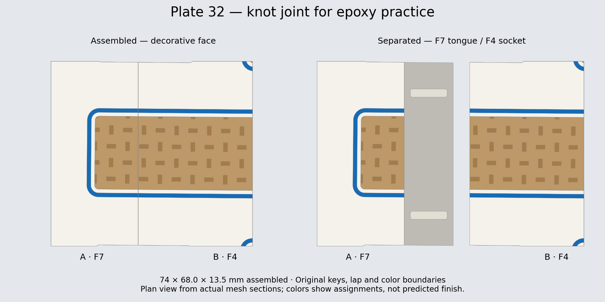

# Full-color knot joint for epoxy practice

Open the normal [Dara.3mf](../../../Dara.3mf) as a project and select **plate 32**. Both halves are arranged and sliced, with support under the socket and a purge tower. No print job has been sent.

This is an **unscaled crop of production joint 1, F7 / F4**, including the original keyed lap, mating shoulders, recessed weave, white rails and flush blue edging. Each half retains its parent's XY print orientation, layer height and process settings. The crop removes distant frame geometry; it does not shorten keys or change joint clearances. Assembled dimensions are **74 × 68 × 13.5 mm**.

| Piece | Plate position | Role |
| --- | --- | --- |
| Knot-Joint-A-F7 | Left | Lower tongue with two raised keys |
| Knot-Joint-B-F4 | Right | Socket; lowers onto A |

The preview is a plan view derived from actual mesh sections. The seam crosses white, wood and blue, allowing a representative squeeze-out and cleanup trial. The surrounding white rail surfaces and full-thickness backs provide room to test clamp/caul placement. The cut ends are sample boundaries, not extra joints.

**Studio estimate:** 41.27 g total, 1 h 45 min 57 s. This includes supports and purge: 37.38 g white, 3.12 g wood tan and 0.77 g blue. Slots are **1 white / 2 wood tan / 4 Azurite blue**; no copper is used. The sample retains four walls and 15% gyroid instead of becoming fully solid.

Remove support residue and dry-fit before adding epoxy. Use the pair to trial the amount applied, masking, clamp placement, squeeze-out access and cleanup timing with your chosen epoxy. Keep the backs coplanar and check whether clamping marks the colored face or raised rails. Follow the epoxy manufacturer's application and cure instructions. A successful small glue-up checks this assembly method; it does not establish the finished wall hanging's load capacity.

## Verification and regeneration

[Validation](../../bambu/Dara-Photo-Frame-A1-Jointed/knot-glue-sample-validation.json) records the source project hash, crop, transforms, mesh checks and all 32 saved G-code hashes. The two cropped bodies are watertight, each is a single component, and the assembled bodies have zero modeled interference. Native Studio round-trip geometry error is below 0.00015 mm. The saved toolpaths contain all three colors, supports, interfaces, gyroid and a purge tower, with no inspection pause. All preceding 31 plate assets and production meshes/settings are unchanged.

The generator is [add_knot_glue_sample.py](../../../scripts/add_knot_glue_sample.py), with `stage`, `slice`, `verify`, and `publish` actions. Staging expects the complete 31-plate Dara from commit `c109cbc`; it refuses to replace a different baseline. It keeps its intermediate files in ignored `.work/knot-glue-sample`. Native slicing requires the installed Bambu Studio CLI. Recheck the published files with `python scripts/integrate_hammered_dara.py audit`.
