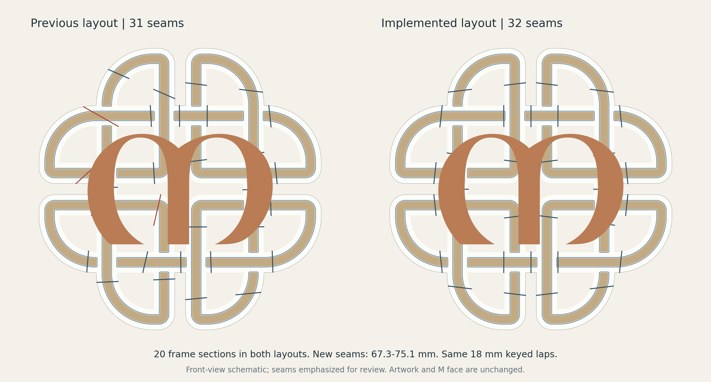

# Mirrored short-seam revision - 2026-10-15

The approved layout prioritizes a deliberate visible seam pattern. It retains 20 frame sections and uses 32 laps, each 67.299-75.055 mm long. The previous 129.126 and 181.239 mm laps are removed. Cut axes mirror across both centerlines; their clipped endpoints follow the slightly asymmetric original artwork. Adjacent seams remain staggered, with at least 34.778 mm between cut segments.

The original artwork, 914.4 mm overall size, photo openings, weave relief, blue accent, 18 mm keyed-lap profile and its clearances are retained. The verified frame print footprints reach 252.124 mm at most. Assembly order is recorded in the manufacturing CAD, printing guide and updated PDF map.

Two rear M screw positions move by 1.5 and 6 mm; locator 12 moves by 1.5 mm. Five photo-tab screws move 5.0-16.8 mm along their openings to clear the new laps. Matching holes and solid reinforcement zones are revised in production M1/M3/M6. Existing bore vertices are relocated and the flat rear triangulated where necessary; the visible hammered face and band seats remain exact. The other three M pieces, all five covers, eight backers, four wall blocks, retainers and optional coupons are unchanged.

## Evidence

- [Native exports](native-export.json): 20 frame and six historical flat-M STLs; watertight, consistent winding, one connected solid each, Z=0 and at least 1.5 mm part-to-bed allowance.
- [Assembly geometry](geometry-validation.json): no frame/frame interference; all 22 rear M sites align; no nominal frame/M collision; continuous artwork and joint tool retained.
- [Saved perimeter audit](perimeter-review.json): all 56 canonical large arcs covered by 318 saved perimeter arcs; maximum radial error 0.0365 mm, below 0.06 mm acceptance.
- [Release validation](release-validation.json): fresh native slices for plates 1-20, 21, 23 and 26; geometry round-trip, material layers, support clearance, bead bounds, motion caps and final package open/save checked. The other nine saved slices are retained exactly.
- [Printable map](../../../output/pdf/Dara-Part-and-Plate-Map.pdf): current frame, actual hammered M, rear hardware and shared plate layouts; all four pages rendered and inspected.

Both distributed production projects have matching release hashes. The read-only `python scripts/audit_dara_release.py` checks their contents and synchronized CAD/STL hashes without migration dependencies. Digital checks do not establish physical fit or finish; use the unchanged plate 32 lap-profile pair for glue practice, then dry-fit the actual sections.

## Regeneration and provenance

`working/geometry/mirrored-frame-layout.json` stores the complete approved partition, seam axes, hardware locations and assembly order. The final SCAD contains the geometry and refreshed preview meshes; ordinary native STL regeneration uses `scripts/export_jointed_stls.py`.

The one-time migration scripts use an immutable `.work/mirrored-joints/baseline` snapshot of the preceding release, whose SHA-256 is recorded in the layout and release reports. `repartition_mirrored_frame.py` applies that layout and renders the frame. `build_mirrored_project.py` revises the production project and prepares a fresh native slicer input. `verify_mirrored_frame.py` checks assembled geometry. `release_mirrored_project.py` validates and merges the affected plates, requires the perimeter and native-open checks, then publishes. These migration scripts are not general-purpose publishers for later revisions.

The six flat M STLs remain historical geometry. Production hammered M meshes and covers are embedded in Dara.3mf. The retained plate 32 coupons came from the previous F7/F4 boundaries and share the unchanged keyed-lap profile; they are not new section crops.
