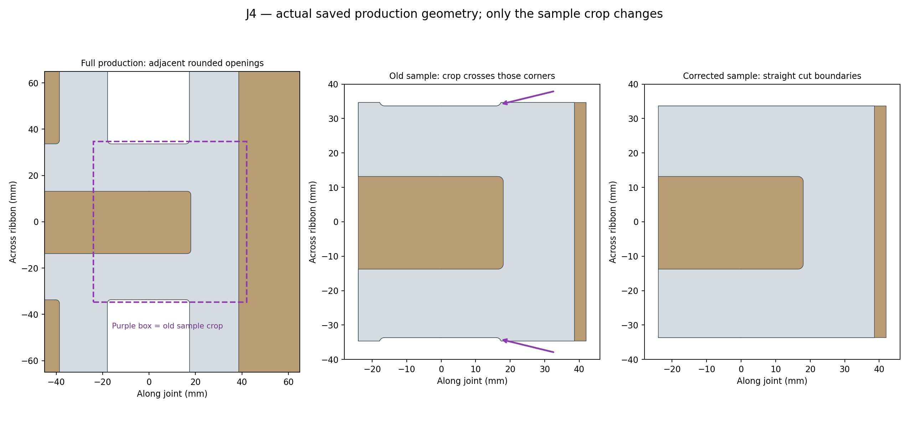

# Production outline and sample crop audit — October 19, 2026

The two scallops marked in the production-joint sample come from its crop crossing rounded corners of adjacent openings in the knot outline. The full production ribbon continues around those openings. The extraction did not introduce missing material into the production joint.

All **14 production joint neighborhoods** were checked directly from the saved `Dara.3mf` meshes against the continuous artwork at Z8.5 and Z13.4. Existing hardware holes were excluded. Every comparison found zero missing outline area beyond a 0.025 mm tolerance and zero excess material beyond the artwork tolerance. These sections address the visible side-outline concern in the screenshot; they do not qualify hidden lap clearance, supported surface finish or physical fit.

The [corrected sample](../../bambu/Dara-A2L-Production-Joint-Sample/Dara-A2L-Production-Joint-Sample.3mf) uses straight cuts at the 67.3035 mm ribbon span, removing the previous crop's extra 1 mm on each side. It still derives directly from production geometry and retains the keys, pads, fit clearances, color volumes, print rotations and process settings. Four geometric checks cover both sample sides at the lower face and the higher white-ribbon face; the brown fabric is correctly excluded from the higher section because it ends at Z9.9.

Only the sample was regenerated and resliced. Root `Dara.3mf`, the named complete and editable A2L projects, all M parts and every A1 companion file remain unchanged. The production SHA-256 remains `b943790d7deefbaa22413106848dd936ccbe26b294372be4d85ea5dee578425d`.

Evidence: [all 14 joint checks and protected-file hashes](outline-audit.json), [sample geometry](../../bambu/Dara-A2L-Production-Joint-Sample/geometry-validation.json), and [sample native validation](../../bambu/Dara-A2L-Production-Joint-Sample/native-validation.json).

Reproduce with `scripts/audit_production_joint_outlines.py`. Regenerate the corrected sample with `scripts/extract_production_joint_sample.py build`, `slice`, then `validate`. No printer job is sent by these commands.
