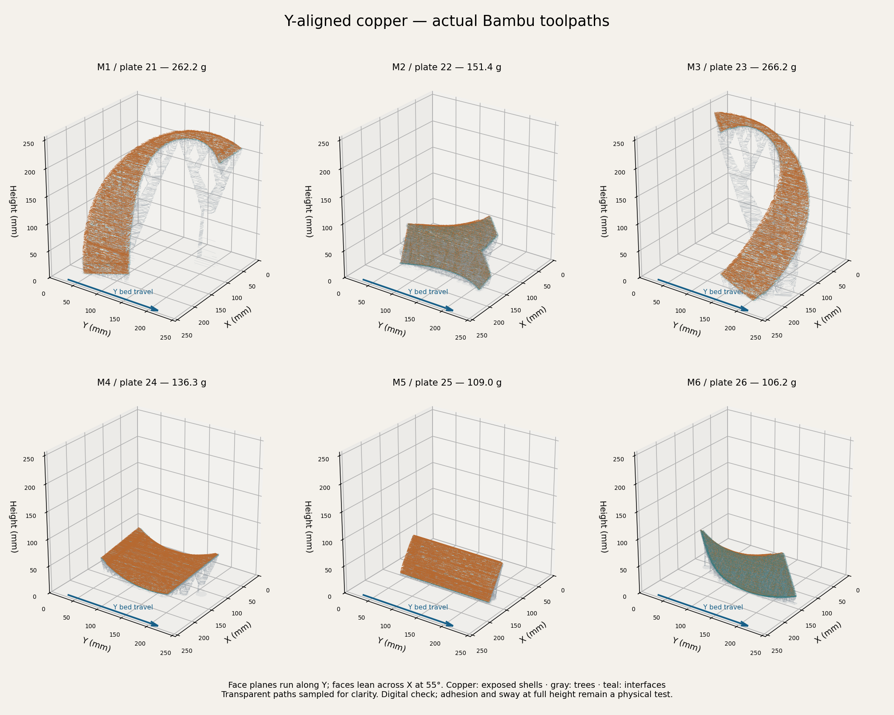
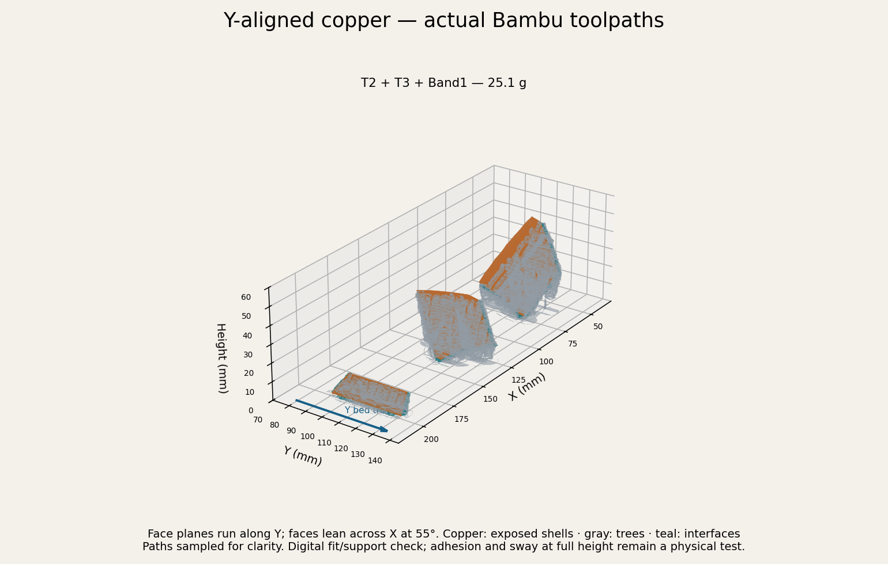

# A1 Y-bed correction — 2026-10-15

Use the normal [Dara.3mf](../../../Dara.3mf), its identical [package copy](../../bambu/Dara-Photo-Frame-A1-Jointed/Dara-Photo-Frame-A1-Complete.3mf), or the corrected [small band test](../../../Dara-Hammered-Band-Test.3mf). All are saved native projects with slices. No print job was started or changed.

The broad copper face planes now run along the A1 bed's Y travel, with the 55-degree lean across X. Each part is rotated within that plane to fit at its original scale. M1 and M3 reach approximately 238 and 241 mm; the other four are 63-102 mm tall. Tree supports are regenerated with 3 mm branch diameter and two walls. A 6 mm outer object brim is requested; where the tilted part has no first-layer area, the generated tree base supplies the anchoring.

The previous placement search minimized the bed footprint without a Y-axis constraint. The replacement fixes world yaw at 90 degrees and searches the rotation within the face for the lowest height that fits. Each nominal face-plane normal maps to approximately (0.81915, 0, 0.57358): the face contains Y, and the lean is across X. T2 and T3 inherit the M2/M3 parent rotations. No geometry is scaled, cropped again for manufacture, or repartitioned. Joint, texture, cover-band, screw and locator geometry remains unchanged.

| Section | Plate | Model X × Y × Z (mm) | Bead edge clearance (mm) | Grams | Time |
| --- | --- | --- | --- | --- | --- |
| M1 | 21 | 172.9 × 237.8 × 238.2 | 6.64 | 262.20 | 23 h 42 min |
| M2 | 22 | 76.1 × 185.2 × 102.0 | 31.63 | 151.45 | 13 h 29 min |
| M3 | 23 | 175.3 × 237.9 × 241.0 | 6.23 | 266.18 | 23 h 54 min |
| M4 | 24 | 63.8 × 213.5 × 81.5 | 18.19 | 136.28 | 11 h 49 min |
| M5 | 25 | 48.4 × 179.3 × 62.8 | 32.32 | 109.05 | 10 h 01 min |
| M6 | 26 | 54.2 × 215.3 × 67.8 | 17.00 | 106.17 | 9 h 11 min |

Clearance includes support paths, bead widths and arc extrema. Heights are model dimensions; slicing uses 0.2 mm layers. M1 and M3 are close to the printer's height limit, so their physical stability remains unverified despite passing the digital fit checks.

Project-wide X/Y limits are 1,000 mm/s² acceleration and 150 mm/s speed. Process travel and default print acceleration are 1,000 mm/s²; outer walls, top surfaces and the first layer use 500 mm/s². Major process speeds are capped at 150 mm/s. All 32 plates were re-sliced, including the frame and optional samples. These conservative settings increase print time; they do not prove physical adhesion or eliminate sway.

The export explicitly contains `M201 X1000 Y1000` and `M203 X150 Y150` axis limits. This matters because conditional firmware inspection code can leave a higher `M204 S5000` request active until the next feature change. The report preserves those raw requested maxima and separately records the Y-axis bounds under the emitted axis limits. No generated G-code was patched. These are configuration checks, not measurements of printer motion. The [Bambu source](https://github.com/bambulab/BambuStudio/blob/master/src/libslic3r/GCode.cpp) is the reference for generated motion commands; this release is checked against the locally installed Studio's actual output.

Supports use the saved tree process, 3 mm branch diameter and two walls. Eligibility is recalculated in the new orientation while blocking the decorative surface and mounting bores. Actual interface paths are checked against the face/seat envelope. Some tilted sections have no model area on layer 1 and therefore no separate `Brim` feature: the slicer builds their anchors as first-layer `Support`. The report records the actual tree-base footprint and does not equate a requested 6 mm brim with a guaranteed continuous brim around every tree.

All 32 plates: **4,101.64 g and 262 h 32 min**. Assembly without optional plates 30 and 32: **4,041.95 g and 258 h 36 min**. Copper plates 21-26 and 31: **1,048.31 g and 94 h 03 min**. Optional plate 30: **18.42 g and 1 h 21 min**; plate 32: **41.27 g and 2 h 33 min**. Estimates include supports and purge. Copper exceeds one 1 kg spool before retries.

The band test is **25.11 g / 3 h 01 min**. It uses the real parent orientations but is too short to validate full-height sway. Keep the standard 100% print-speed setting when evaluating these limits; changing the speed mode changes the trial.

## Verification and reproduction

[Normal project](normal-validation.json), [small test](test-validation.json), and [seven-plate copper project](candidate-validation.json) record hashes, settings, native mesh comparisons, support contacts, bed bounds, motion commands and estimates. All 78 normal-project instances are retained, including 32 retainers and the full-color epoxy pair. Non-copper geometry and placements are preserved; every plate is freshly sliced. Earlier frame plate 6 has 0.634 mm bead clearance, unchanged from its baseline; the stricter 1.5 mm minimum applies to the newly oriented copper plates.

`scripts/prepare_y_stable_dara.py` migrates the exact pre-correction release from commit `85d0690`. Its immutable input copies and slicer intermediates live in ignored `.work/y-stable-dara`; it refuses a different input hash. Sequence: `stage`, `slice test`, `verify test`, `slice normal`, `verify normal`, `slice candidate`, `verify candidate`, `render test`, `render normal`, `publish`. Native slicing requires the installed Bambu Studio CLI. The general copper generator now uses the same Y-alignment helper for future generation. The untouched historical geometry reports retain the old placement transforms; the current poses are in these new reports.

Run `python scripts/integrate_hammered_dara.py audit` to check the distributed normal project and all 32 G-code hashes. Physical adhesion, support removal, glue fit and full-height stability remain to be tested.
