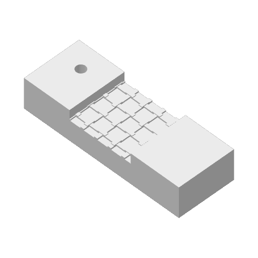
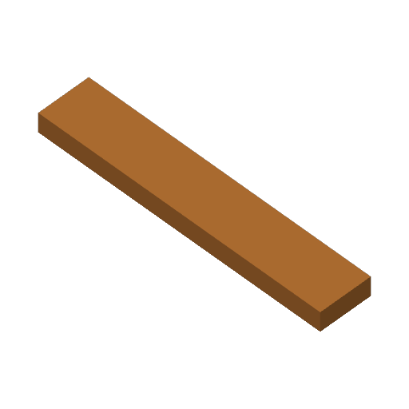

# Separate weave/blue-edge and copper tests

Open the [complete Bambu project](../../bambu/Dara-Photo-Frame-A1-Jointed/Dara-Photo-Frame-A1-Complete.3mf). The previously printed hardware/lap coupons have been removed from the plate layout. Their standalone STL files are retained here.

| Plate | Piece | Materials and settings | Estimate |
| --- | --- | --- | --- |
| 30 | Test-Weave-Full-Width | White/wood/Azurite blue Generic PLA; 65 C bed | 18.44 g; 0 h 59 min |
| 31 | Test-M-Letter | Copper Generic PLA Silk; 55 C bed | 23.28 g; 1 h 10 min |

Both use the A1, 0.4 mm nozzle, 0.2 mm layers, four walls, and 15% gyroid. Copper retains its local solid screw zone, silk flow/retraction settings, and 40 mm/s outer-wall/top-surface speeds. It prints with zero filament changes on its own plate.

The weave coupon is **68.45 mm wide x 24 mm long x 13.5 mm high**, cropped from the restored F7 mesh. Both white side rails remain intact; only the short ends are cut. The recessed backing and raised threads include the alternating **3.3 x 1.5 x 0.3 mm crossing pads**. Wood is assigned at Z=8.4-9.9 mm, layers 43-50, with eight wood/white color changes. A **1.5 mm blue line**, inset **1.25 mm** from the weave, finishes flush on each rail. Blue uses slot 4 and occupies layers 66-68 (three more changes, **11 total**). Inspect the actual texture, blue opacity and clean white boundaries in Preview's Filament view and on the printed sample.

The model thumbnails use the base color for filament modifiers; sliced Filament Preview shows the final wood and blue assignments. [Plate 30 manifest](plate-30-manifest.json) and [plate 31 manifest](plate-31-manifest.json) record source hashes, placements, and audited slice results. The standalone [weave STL](Test-Weave-Full-Width.stl) has no color settings; use the complete 3MF for the three-color test.

## Previously printed fit coupons

The photo, B1 wall-block/socket, M interface pair, and F7/F4 lap pair remain as standalone STL files for reference. The user reports insufficient photo room with the former 2.0 mm recess, possibly due to support roughness. [Test-Photo-Frame.stl](Test-Photo-Frame.stl) and [Photo-Fit-Sample.stl](Photo-Fit-Sample.stl) now use a **2.4 mm rabbet**, leaving 0.8 mm beyond the existing 1.6 mm backer. The backer and tab samples retain their dimensions. The revised physical fit is unverified. Other archived coupons retain their earlier geometry; the [manifest](manifest.json) records per-file source hashes. These fit coupons are not added to the current 31-plate layout.

Test-M-Letter on plate 31 remains the original crop of M5, including its screw stack and locating holes. For any repeated fit check, use its retained Test-M-Frame mate, a selected #6-19 x 1/2-inch plastic thread-forming screw, and a 10 mm OD x 4 mm ID x 1 mm washer. The outside cropped edges are sample boundaries, not mating features.
